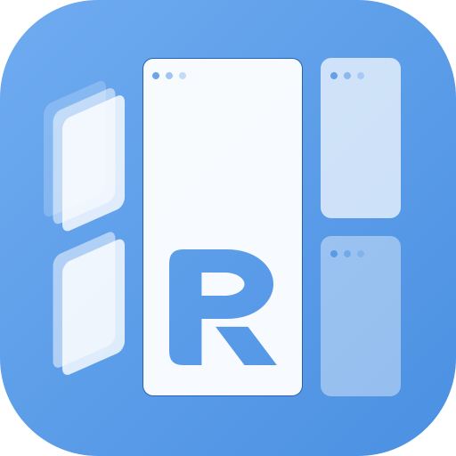
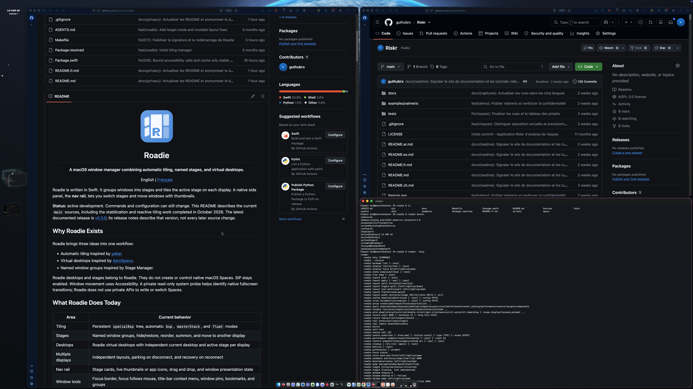

<div align="center">
  

# Roadie

**Un gestionnaire de fenêtres macOS qui combine disposition automatique, stages nommés et bureaux virtuels.**

[English](README.md) | Français

</div>

Roadie est écrit en Swift. Il regroupe les fenêtres dans des stages et organise le stage actif sur chaque écran. Un panneau latéral natif, le **nav rail**, permet de changer de stage et de déplacer les fenêtres avec des vignettes.

**État du projet :** développement actif. Les commandes et la configuration peuvent encore changer. Ce README décrit le projet actuel, avec les derniers correctifs du tiling réactif, du glisser-déposer entre écrans, du nav rail, du retour d’écran, de la signature et du redémarrage. Compile les sources de `main` pour utiliser ce code.

<p align="center">
  
</p>

## Pourquoi Roadie Existe

Roadie réunit trois idées dans un même usage :

- Une disposition automatique des fenêtres (tiling), inspirée de [yabai](https://github.com/koekeishiya/yabai).
- Des bureaux virtuels, inspirés de [AeroSpace](https://github.com/nikitabobko/AeroSpace).
- Des groupes de fenêtres nommés, inspirés de Stage Manager.

Les bureaux et les stages appartiennent à Roadie. Ils ne créent pas et ne pilotent pas les Spaces natifs de macOS. SIP reste actif. Les déplacements utilisent Accessibilité. Une sonde système privée en lecture seule aide à reconnaître les transitions de plein écran natif. Roadie n’utilise pas d’API privée pour modifier les Spaces ou changer de Space.

`roadie toggle maximize` agrandit la fenêtre active en gardant la bande du navrail visible libre. Relance la commande pour restaurer la disposition. Les voisines de la même stage sont cachées pendant la maximisation. Avec le masquage automatique, le rail masqué laisse toute la zone utile, comme le plein écran Roadie. Quand il revient au survol ou avec `roadie rail pin`, la fenêtre se redimensionne pour lui laisser la place, sans quitter la maximisation. Le menu de titre propose aussi « Fenêtre → Maximiser / restaurer (garder le navrail) » lorsqu'il est activé.

`roadie toggle fullscreen` utilise toute la zone utile, avec le rail au-dessus. `roadie toggle native-fullscreen` utilise le plein écran macOS. Les deux modes Roadie peuvent se remplacer directement ; répéter le mode actif restaure la disposition précédente.

## Ce Que Fait Roadie Aujourd’hui

| Domaine | Comportement actuel |
|---|---|
| Tiling | Arbre persistant `spatialBsp`, modes automatiques `bsp`, `masterStack` et `float` |
| Stages | Groupes nommés, masquage, restauration, réorganisation et déplacement vers un autre écran |
| Bureaux | Bureaux virtuels Roadie, avec bureau courant et stage actif indépendants sur chaque écran |
| Multi-écran | Dispositions indépendantes, parking au débranchement et récupération au retour |
| Nav rail | Cartes de stages, vignettes ou icônes, glisser-déposer et état de présentation des fenêtres |
| Outils de fenêtre | Bordure de focus, focus à la souris, menu de barre de titre, épinglages, signets et groupes |
| Automatisation | CLI, requêtes JSON, événements JSONL, règles TOML et rechargement de configuration |
| Sûreté | Sauvegardes, écriture atomique, récupération des fenêtres masquées, verrous et contrôles de santé |
| Modes facultatifs | Cibles clavier, découverte des zones applicatives, grilles écran/fenêtre et macros courtes |
| Exécution | Un daemon pour l’usage quotidien, ou des composants séparés |

### Tiling Réactif Et Glisser-Déposer

`spatialBsp` conserve la disposition dans un arbre binaire persistant. Cet arbre garde les séparations et leurs proportions. Une nouvelle fenêtre partage la case de la fenêtre active selon son côté le plus long. Une fenêtre fermée rend sa place à sa voisine dans l’arbre. Les fenêtres temporairement absentes gardent leur place dans l’arbre enregistré, sans recevoir de placement.

Les événements d’Accessibilité et des applications déclenchent les mises à jour. Roadie regroupe les rafales et ignore les notifications causées par ses propres placements. Un contrôle périodique de secours reste actif. Roadie suspend les écritures de disposition pendant le déplacement à la souris, puis applique le dépôt.

- Sur le même écran et dans le même stage, un dépôt au centre échange les deux positions. Un dépôt sur un bord insère la fenêtre de ce côté.
- Entre écrans, l’aperçu suit le pointeur. Un dépôt au centre insère à droite de la cible. Un dépôt sur un bord suit ce bord. Un stage tilé vide peut aussi recevoir la fenêtre.
- Une fenêtre échangée prend la case de destination. Si une application refuse une petite taille, Roadie ajuste les séparations concernées pour respecter sa taille minimale. Un minimum large peut donner un résultat proche de l’équilibre.
- Au retour d’un écran, Roadie conserve les dernières positions visibles utiles. Une ancienne référence enregistrée ne suffit pas à créer une carte de fenêtre visible dans le rail.

`mutableBsp` et `yabai` restent des alias de `spatialBsp`. Les anciens stages `mutableBsp` migrent une seule fois. Roadie sauvegarde l’état précédent sous le nom `stages.json.pre-017` dans son dossier d’état local.

Pour modifier l’arbre, utilise `move`, `warp`, `resize`, `window swap`, `layout split` et `layout toggle-split`. Dans ce mode, `layout insert` et `layout join-with` sont refusés : utilise `warp`. `layout width` est aussi refusé : utilise `resize`. `layout flatten` équilibre l’arbre existant. Il ne le reconstruit pas depuis les positions des fenêtres.

### Stages, Bureaux Et Nav Rail

Chaque écran affiche uniquement le stage actif de son bureau Roadie courant. Les autres stages restent masqués et accessibles dans le nav rail. Tu peux déplacer une vignette entre stages, la ramener dans l’espace actif ou envoyer un stage entier vers un autre écran.

Le rail distingue les fenêtres normales, agrandies et en plein écran natif. Il se masque par défaut devant le plein écran natif. Le masquage devant une fenêtre agrandie est configurable. Enregistrement d’écran permet les vignettes en direct. Sans cette permission, les icônes restent disponibles.

Quand un écran disparaît, Roadie place ses stages non vides sur un écran restant. Il garde leur origine pour les remettre en place quand l’écran est reconnu sans ambiguïté. Les épinglages gardent certaines fenêtres visibles pendant les changements de stage. Les signets permettent de revenir à une fenêtre choisie. Les groupes persistants permettent un usage limité de type pile.

### Stabilisation Et Récupération

Le daemon partage un cache des fenêtres et protège les modifications d’état avec un verrou de fichier unique. Les écritures sont atomiques. Les fichiers invalides restent conservés pour le diagnostic. Si une nouvelle configuration est invalide, Roadie garde la dernière configuration valide.

Les commandes passent normalement par un socket Unix local. Le daemon utilise ses propres permissions macOS. Les requêtes de santé, les événements, les audits d’état et les résumés de performance aident au diagnostic.

`make restart` arrête maintenant une instance ouverte directement comme application, ainsi que le service installé. L’installation conserve le certificat de signature exact quand il est disponible. Cela aide à garder la permission Accessibilité. L’arrêt et le processus de surveillance des crashs restaurent les fenêtres masquées.

### Fonctions Facultatives Et Expérimentales

Le Mode Cibles propose des labels clavier, une recherche, une inspection, une activation et une sortie JSON. La découverte des zones applicatives, les grilles récursives écran/fenêtre et les macros souris courtes sont expérimentales. Chaque fonction a son propre réglage d’activation.

Le mode modulaire sépare `tiler`, `rail`, `border`, `focus-mouse`, `titlebar-menu` et `target-mode` en processus distincts. Le lanceur standard démarre l’ensemble. Un usage limité aux stages ou aux effets visuels avec un autre gestionnaire demande encore des profils de démarrage dédiés.

La gestion des Spaces natifs, les raccourcis globaux intégrés et un installateur public validé par Apple restent hors du périmètre actuel. Certaines commandes listées, comme `window close` et `toggle floating`, signalent explicitement qu’elles ne sont pas implémentées. La refonte abandonnée des popovers d’épinglage ne fait pas partie des fonctions livrées.

## Documentation

La documentation complete existe en francais et en anglais :

- [Documentation francaise](docs/fr/README.md)
- [English documentation](docs/en/README.md)

Guides principaux :

- [Vue d'ensemble des fonctionnalites](docs/fr/features.md)
- [Commandes CLI](docs/fr/cli.md)
- [Configuration et rules](docs/fr/configuration-rules.md)
- [Evenements et Query API](docs/fr/events-query.md)
- [Cas d'usage](docs/fr/use-cases.md)

## Prérequis

- macOS 14 ou plus récent.
- Xcode Command Line Tools. Xcode complet n’est pas nécessaire.
- Permission Accessibilité pour `roadied`.
- Permission Enregistrement d’écran pour `roadied`, seulement si tu veux les vraies thumbnails dans le rail.
- Outils facultatifs : `tmux` pour le runtime modulaire, `create-dmg` pour construire le DMG.

Installer Xcode Command Line Tools si besoin :

```bash
xcode-select --install
```

Les scripts du projet utilisent `/Applications/Xcode.app` s’il existe. Sinon, ils utilisent les Command Line Tools indiquées par `xcode-select -p`. Ils nettoient aussi l’environnement shell des variables qui peuvent injecter des flags linker incompatibles. Si aucune toolchain Swift n’est trouvée, le script s’arrête et te demande d’installer les Command Line Tools.

## Build Et Lancement De Développement

Depuis la racine du dépôt :

```bash
make test
make dev-start
```

`make dev-start` sert au développement. Il compile en mode debug, copie les binaires dans `./bin` seulement, décharge le LaunchAgent installé et lance le daemon dans une session `tmux`. Il ne touche pas aux binaires installés par `make install`. Dans ce mode, utilise `./bin/roadie` et donne l’Accessibilité à `bin/roadied` de ce dossier. Pour l’usage quotidien, installe Roadie avec `make install`.

**Un seul lanceur à la fois.** `roadied run` et `roadied tiler` prennent un verrou d’instance (`~/.roadies/roadied.lock`). Une deuxième instance sort avec le code 1. Le LaunchAgent relance un processus qui échoue (`KeepAlive`) : il réessaierait en boucle si une session `tmux` fait déjà tourner le daemon. Pour cette raison :

- `make dev-start` et `./scripts/start-modular` déchargent d’abord le LaunchAgent ;
- `make restart` ne lance jamais `tmux`, et il refuse de s’exécuter tant qu’une session de développement existe. Lance d’abord `make stop` ;
- pour revenir au service installé, lance `make stop`, puis `make restart`.

## Installation Manuelle

Pour une installation locale manuelle depuis les sources :

```bash
make install
```

Cette cible masque la mise en place macOS habituelle :

- build `roadie` et `roadied` en mode release ;
- installe le daemon comme application `~/Applications/Roadie.app`, avec son nom et son icône dans les réglages de confidentialité ;
- installe la commande et un lien vers le daemon hors du dépôt : le service continue de marcher si tu déplaces ou supprimes le dossier source ;
- signe l’application et la commande (voir plus bas) ;
- crée le LaunchAgent, qui lance le daemon depuis l’application ;
- démarre le LaunchAgent s’il n’est pas déjà chargé.

Ajoute `~/.local/bin` à ton `PATH` pour pouvoir taper `roadie` dans un terminal.

Si Roadie tourne déjà, `make install` ne l’arrête pas. Lance ceci quand tu veux que le daemon recharge les nouveaux binaires installés :

```bash
make restart
```

`make restart` arrête Roadie, puis recharge le service installé avec launchd. Il arrête aussi une instance ouverte directement comme application. Le démarrage vérifie que launchd et le fichier PID désignent le même processus vivant. Il ne compile rien. Le rechargement applique aussi les changements du LaunchAgent.

Après une mise à jour, lance `make install`, puis `make restart`, puis `roadie query health`. Si une session de développement tmux tourne, lance d’abord `make stop`.

### Signature du code et permissions

macOS lie la permission Accessibilité à la signature de Roadie. `make install` reprend le certificat exact de l’application installée quand son empreinte est disponible. Si ce certificat manque dans le trousseau, l’installation s’arrête avant de remplacer l’application. Un certificat du même nom ne suffit pas. Un choix explicite avec `ROADIE_CODESIGN_IDENTITY` reste prioritaire. À la première installation, il utilise `roadied-cert` si cette identité existe dans le trousseau. Sinon, il utilise une signature ad hoc et affiche un avertissement : macOS peut oublier la permission après une nouvelle compilation.

Pour choisir une identité stable explicitement :

```bash
security find-identity -v -p codesigning
ROADIE_CODESIGN_IDENTITY="Apple Development: Ton Nom (TEAMID)" make install
```

Si tu veux seulement installer les fichiers sans démarrer le LaunchAgent :

```bash
ROADIE_INSTALL_NO_START=1 make install
```

Commandes utiles :

```bash
make test
make build
make install
make uninstall
make dev-start
make stop
make restart
make status
make logs
make doctor
make dmg
```

Équivalents directs :

```bash
./scripts/test
./scripts/start        # make dev-start
./scripts/stop
./scripts/status
./scripts/logs
./scripts/roadie query health
```

Les logs sont dans `~/.roadies/`. À chaque démarrage, le log précédent est conservé sous `roadied.stdout.log.1` et `roadied.stderr.log.1`. Un crash reste donc lisible après un redémarrage.

## Désinstallation

```bash
make uninstall
```

Le script fait ces étapes dans l’ordre :

1. lance `roadie restore unhide-all` pour qu’aucune fenêtre ne reste masquée ou hors écran ;
2. arrête le LaunchAgent (`launchctl bootout`) ;
3. supprime le fichier LaunchAgent, `~/Applications/Roadie.app` et les binaires de `~/.local/bin` ;
4. demande s’il faut garder l’état de Roadie (`~/.roadies`, `~/.local/state/roadies`). Sans terminal, il le garde.

Le script ne supprime jamais ta configuration dans `~/.config/roadies`. Supprime-la à la main si tu le souhaites. Pour finir, retire Roadie de Réglages Système > Confidentialité et sécurité > Accessibilité et Enregistrement d’écran.

## Runtime Modulaire

Le chemin classique (`make install`, ou `make dev-start` en développement) lance Roadie comme un daemon unique. Le chemin
modulaire lance les memes capacites sous forme de processus separes :

```bash
./scripts/start-modular
roadie query components
roadie query health
```

Le script modulaire standard lance aujourd'hui tout le set de composants, y
compris le tiler. L'interet architectural est plus large : permettre a Roadie de
devenir non seulement un window manager complet, mais aussi un ensemble de
composants utilisables comme couche compagnon avec yabai, AeroSpace ou un autre
gestionnaire de fenetres.

Cet usage "companion mode" reste volontairement note comme experimental : les
frontieres runtime, les locks de composants, la sante par composant et les logs
separes sont en place, mais les profils explicites "stage-only" ou
"overlay-only" restent a formaliser.

## Build DMG Et Installation Non Signée Apple

Roadie peut être packagé dans un DMG macOS classique :

```bash
make dmg
```

Le résultat est :

```text
dist/Roadie.dmg
```

Le DMG contient `Roadie.app` et un raccourci `/Applications`, donc l’installation se fait par drag-and-drop classique.

Important : ce build est signé ad-hoc, pas signé avec un certificat Apple Developer ID, et pas notarized par Apple. macOS Gatekeeper ne le considérera donc pas comme une app publique entièrement approuvée.

Pour les utilisateurs, le premier lancement attendu est :

1. Glisser `Roadie.app` dans `/Applications`.
2. L’ouvrir une première fois avec clic droit > Ouvrir, puis confirmer. Roadie démarre comme une app de fond sans menu ni fenêtre.
3. Si macOS bloque encore l’app, lancer :

```bash
xattr -dr com.apple.quarantine /Applications/Roadie.app
```

4. Donner les permissions à `/Applications/Roadie.app` dans Réglages Système > Confidentialité et sécurité :

- Accessibilité.
- Enregistrement d’écran, si les thumbnails live du nav rail sont souhaitées.

Cette limite est normale tant que l’app n’est pas signée avec un certificat Apple Developer ID et notarized par Apple.

Le DMG demande `create-dmg` (`brew install create-dmg`). Le script vérifie ses outils d’abord et s’arrête avec un message clair s’il en manque un.

L’app n’a ni icône dans la barre des menus, ni icône dans le Dock. Pour la quitter, quitte `roadied` dans le Moniteur d’activité. Pour la désinstaller, quitte `roadied`, puis glisse `Roadie.app` dans la corbeille.

L’app packagée démarre aujourd’hui Roadie pour la session utilisateur courante. Un futur installateur signé pourra ajouter automatiquement un login item ou un LaunchAgent ; pour l’instant, le démarrage au login reste volontairement explicite.

## Permissions

Roadie demande deux permissions. Les deux vont au daemon `roadied`.

| Permission | Sert à | Obligatoire |
|---|---|---|
| Accessibilité | Lire et déplacer les fenêtres | Oui |
| Enregistrement d’écran | Thumbnails live des fenêtres dans le rail | Non. Sans elle, le rail affiche des icônes d’app. |

Après `make install`, donne les permissions à **Roadie**, l’application installée dans `~/Applications/Roadie.app`. La commande `~/.local/bin/roadied` pointe vers son daemon. Dans le sélecteur de fichier, utilise Cmd+Maj+G pour ouvrir le dossier de l’application. Puis redémarre et contrôle le daemon :

```bash
make restart
roadie query health
```

### La commande `roadie` n’a besoin d’aucune permission

Quand le daemon tourne, la commande `roadie` lui envoie ta demande par un socket local (`~/.roadies/roadied.sock`). Le daemon fait le travail avec ses propres permissions. BetterTouchTool, Karabiner, skhd ou un script shell qui appelle `roadie` n’ont donc pas besoin de la permission Accessibilité. La commande ne scanne pas non plus toutes les fenêtres à chaque appui de touche, ce qui accélère les raccourcis.

Si le daemon est arrêté, `roadie` exécute la commande lui-même. Dans ce cas, le programme qui l’a lancé (terminal, BetterTouchTool) a besoin de la permission Accessibilité. Certaines commandes tournent toujours en local : `daemon start|stop|restart|health`, `doctor`, `permissions` et `config validate`.

Utilise `roadie query health` pour contrôler le daemon avec ses propres permissions. `roadie doctor` lit aussi son statut et vérifie la configuration. Les contrôles locaux de `doctor` et `daemon health` peuvent relever les fenêtres avec les permissions du terminal. Un relevé local vide ne signifie pas que le daemon ne voit aucune fenêtre. Le daemon publie cet état dans `~/.roadies/daemon-status.json` (identifiant du processus, version, permissions, validité de la configuration, heure de mise à jour), et `roadie doctor` lit ce fichier. Doctor considère le daemon arrêté quand son processus a disparu ou quand le fichier a plus de 90 secondes.

## Configuration

Le fichier de configuration utilisateur est :

```text
~/.config/roadies/roadies.toml
```

Un exemple commenté est dans [`examples/roadies.toml`](examples/roadies.toml). Copie-le comme point de départ :

```bash
mkdir -p ~/.config/roadies
cp examples/roadies.toml ~/.config/roadies/roadies.toml
```

Valider la configuration :

```bash
roadie config validate
```

La validation signale chaque problème avec le nom complet de la clé :

- `error  focus.stage_follows_focus  attendu booléen, reçu texte` : une valeur a le mauvais type ;
- `warning  tiling.gaps_inr  clé inconnue, ignorée ; vouliez-vous dire « gaps_inner » ?` : une faute de frappe, avec la clé valide la plus proche ;
- `warning  desktops.count  clé sans effet` : Roadie lit la clé dans le fichier mais ne l’utilise pas. C’est le cas de toute la table `[desktops]` et de `enabled` et `hide_strategy` dans `[stage_manager]`.

Des exemples de raccourcis pour skhd et Karabiner-Elements sont dans `examples/skhd/skhdrc` et `examples/karabiner/roadie.json`. Voir [Raccourcis](docs/fr/cli.md#raccourcis).

Afficher la configuration chargée :

```bash
roadie config show
```

Valider et inspecter les rules :

```bash
roadie rules validate --config ~/.config/roadies/roadies.toml
roadie rules list --json
roadie rules explain --app Terminal --title roadie --role AXWindow --stage dev
```

## Usage Quotidien

Démarrer ou redémarrer le daemon :

```bash
make restart
```

Vérifier l’état runtime :

```bash
roadie query health
roadie state audit
roadie metrics
roadie tree dump
```

Lister les fenêtres et les écrans :

```bash
roadie windows list
roadie display list
```

Changer le mode de layout de la stage courante :

```bash
roadie mode spatialBsp   # alias : mutableBsp, yabai
roadie mode bsp
roadie mode masterStack
roadie mode float
```

Déplacer le focus ou les fenêtres :

```bash
roadie focus left
roadie focus right
roadie focus back-and-forth
roadie move left
roadie warp right
roadie resize left
roadie display focus right
```

Envoyer la fenêtre active vers un autre écran :

```bash
roadie window display 2
```

## Stages

Les stages sont des groupes de fenêtres. Seule la stage active est visible ; les stages inactives sont masquées et représentées dans le nav rail.

Commandes courantes :

```bash
roadie stage list
roadie stage create 4
roadie stage rename 4 Comms
roadie stage switch 2
roadie stage assign 2
roadie stage switch-position 2
roadie stage assign-position 2
roadie stage switch-visible next
roadie stage switch-visible prev
roadie stage assign-empty
roadie stage reorder 2 1
roadie stage delete 4
roadie stage prev
roadie stage next
```

`stage switch` et `stage assign` ciblent les identifiants stables. `stage switch-position` et `stage assign-position` ciblent l’ordre visible du nav rail. `stage switch-visible prev|next` parcourt uniquement les stages non vides. `stage assign-empty` envoie la fenêtre active vers le prochain stage vide sans nom et le crée si nécessaire.

Ramener dans la stage active une fenêtre d’une stage inactive :

```bash
roadie stage summon WINDOW_ID
```

Déplacer le stage actif vers un autre écran :

```bash
roadie stage move-to-display 2
roadie stage move-to-display right
roadie stage move-to-display right --no-follow
```

Sans option, Roadie suit `[focus].stage_move_follows_focus`. `--follow` et `--no-follow` remplacent ce réglage pour une commande. Le menu d’une carte du nav rail propose la même action.

## Desktops Roadie

Les desktops Roadie sont des desktops virtuels gérés par Roadie. Ils ne créent, ne switchent et ne contrôlent pas les Spaces macOS natifs.

```bash
roadie desktop list
roadie desktop current
roadie desktop focus 2
roadie desktop focus next
roadie desktop focus prev
roadie desktop focus back
roadie desktop back-and-forth
roadie desktop summon 3
roadie desktop label 2 DeepWork
```

## Commandes Layout Power-User

```bash
roadie layout split horizontal
roadie layout split vertical
roadie layout toggle-split
roadie warp right
roadie layout flatten
roadie layout zoom-parent
```

Dans `spatialBsp`, ces commandes modifient l’arbre enregistré ou son état de zoom. Utilise `warp` pour une insertion et `resize` pour un changement de taille. Les anciennes commandes `layout insert`, `layout join-with` et `layout width` sont refusées dans ce mode. Elles restent disponibles dans les autres modes compatibles.

## Groupes De Fenetres

```bash
roadie group create terminals 12345 67890
roadie group add terminals 11111
roadie group focus terminals 67890
roadie group remove terminals 12345
roadie group dissolve terminals
roadie group list
```

Les groupes sont persistés dans l'état des stages Roadie et exposes via `roadie query groups`.

## Automation

Suivre les evenements live :

```bash
roadie events subscribe --from-now --initial-state
```

Lire les projections JSON stables :

```bash
roadie query state
roadie query windows
roadie query displays
roadie query desktops
roadie query stages
roadie query groups
roadie query rules
roadie query health
roadie query events
```

Envoyer la fenêtre active vers un autre desktop Roadie :

```bash
roadie window desktop 2
roadie window desktop 2 --follow
```

## Nav Rail

Le nav rail est un panneau latéral natif par écran.

Il affiche les stages non vides, les thumbnails live quand elles sont disponibles, des icônes d’app fallback quand la capture n’est pas disponible, et un halo autour de la stage active.

Interactions supportées :

- Cliquer sur une pile de thumbnails pour changer de stage.
- Un clic dans une zone vide du rail ne fait rien par défaut, pour qu’un clic raté ne masque pas la stage active. Mets `empty_click_hide_active = true` seulement si tu veux qu’une zone vide bascule vers une stage vide.
- Drag une thumbnail vers une autre stage pour y déplacer la fenêtre.
- Drag une thumbnail vers la scène active pour la ramener.
- Drag une thumbnail vers une zone vide du rail pour la placer dans une stage vide ou nouvellement créée.
- Utiliser les chevrons au-dessus et au-dessous d’une stage pour réordonner les stages.

Le rendu du rail se configure dans `~/.config/roadies/roadies.toml`.

Par défaut, le rail se masque devant une fenêtre en plein écran natif macOS. Pour le masquer aussi devant une fenêtre agrandie, mets `hide_on_maximized = true` dans `[fx.rail]`.

## Mode Cibles, Grille Ecran Et Grille Fenetre

Roadie expose un **Mode Cibles** : des labels courts pour les fenetres, stages,
ecrans, desktops, bookmarks et, en option, les zones applicatives Accessibility.
Ces cibles peuvent etre cherchees, inspectees, activees et exportees en JSON
pour des scripts ou des agents.

Roadie fournit aussi deux grilles recursives :

- **Grille Ecran** pour cibler un ecran complet.
- **Grille Fenetre** pour cibler la fenetre actuellement focussee.

Les deux grilles utilisent le meme langage spatial : taper le label d'une
cellule zoome dedans, `Espace` valide, les fleches deplacent la selection et
`Esc` annule. Les macros courtes peuvent stocker le meilleur contexte de cible
plus un fallback grille.

```bash
roadie targets interactive --source all --include-app-targets
roadie grid interactive --scope display
roadie grid interactive --scope focused_window
roadie record start demo --duration 10
```

Les surfaces risquées sont expérimentales et activables séparément dans
`[experimental.target_mode]`, `[experimental.app_targets]`,
`[experimental.target_grid]` et `[experimental.target_record]`.

## Dépannage

Lancer les vérifications rapides :

```bash
roadie query health
roadie state audit
roadie self-test
```

Réparer les problèmes d’état conservateurs :

```bash
roadie state heal
roadie daemon heal
```

Inspecter logs et événements :

```bash
make logs
roadie events tail 50
```

Obtenir un rapport complet sur le daemon, les deux permissions et la configuration :

```bash
roadie doctor
roadied --version
```

`roadied --version` (et `roadie --version`) affiche la version, utile pour comparer le binaire installé avec le daemon en marche.

Si des fenêtres restent masquées ou hors écran (par exemple après un crash), ramène-les toutes :

```bash
roadie restore unhide-all
```

Si les fenêtres ne bougent plus après une nouvelle installation, vérifie que Roadie est toujours activé dans Accessibilité (voir [Signature du code et permissions](#signature-du-code-et-permissions)), puis redémarre :

```bash
make restart
```

Le daemon remet les fenêtres masquées quand il reçoit un signal d’arrêt (SIGTERM, SIGINT, SIGHUP), et un petit processus de surveillance fait de même si le daemon plante. Pour lancer le daemon sans cette sécurité, démarre-le avec `roadied run --yes --no-restore-safety`.

Les logs du lancement précédent sont dans `~/.roadies/roadied.stderr.log.1` et `~/.roadies/roadied.stdout.log.1`.

## Confidentialité

Roadie fonctionne localement. Les sources actuelles de l’application ne contiennent aucun service de télémétrie ou d’envoi distant. Les commandes CLI passent par un socket Unix local. Enregistrement d’écran reste facultatif et sert aux vignettes des fenêtres.

L’état local et les diagnostics peuvent contenir des titres de fenêtres, des noms d’applications, des identifiants d’écrans, des positions et l’historique des événements. Les macros peuvent garder un contexte de cible. Considère la configuration, les sauvegardes, les logs, les exports, les macros et les captures du bureau comme privés. Relis et anonymise ces fichiers avant de les partager ou de les ajouter à Git.

Le dépôt contient les sources et des données d’exemple ou de test. Les dossiers d’exécution locaux, les fichiers d’environnement, les clés de signature et les métadonnées SpecKit propres à la machine sont exclus de Git. Vérifie le contenu des captures avant publication. Ces contrôles ne retirent pas les données des anciens commits ni des copies déjà téléchargées.

## Organisation Du Dépôt

```text
Sources/RoadieAX       Snapshots système et Accessibilité
Sources/RoadieCore     Types partagés, géométrie, configuration
Sources/RoadieTiler    Stratégies de layout pures
Sources/RoadieStages   État persistant desktops et stages Roadie
Sources/RoadieDaemon   Services daemon, rail, bordure, commandes
Sources/roadie         CLI
Sources/roadied        Point d’entrée daemon
Tests                  Tests unitaires
scripts                Helpers build et runtime
examples               Config d’exemple, raccourcis skhd et Karabiner
```

## Statut

Roadie est d’abord construit pour un usage quotidien personnel. Les commandes, les clés de configuration et le comportement du rail peuvent encore changer pendant la stabilisation.
