<div align="center">

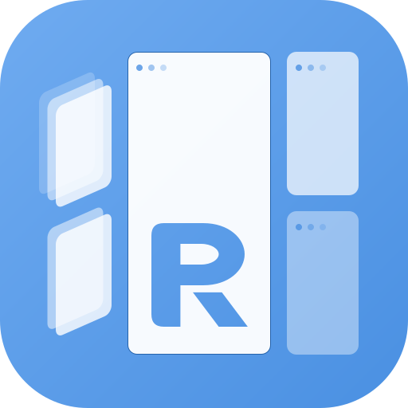

# Roadie

**Le moteur d’espace de travail macOS tout-en-un en Swift natif : tuilage automatique & ruban 120 Hz, lanceur compatible workflows Alfred gratuits, OCR local Apple Vision au mot exact et saut direct dans *Ouvrir / Enregistrer sous*.**

[](https://github.com/guthubrx/roadie/releases/tag/v0.14.0)
[](Package.swift)
[](LICENSE)
[](#confidentialité)

[English](README.md) · **Français**

<p>
  <a href="#les-6-super-pouvoirs-de-roadie">Super-pouvoirs</a> •
  <a href="#démarrage-en-30-secondes">Installer</a> •
  <a href="#comparatif-rapide">Comparatif</a> •
  <a href="#permissions">Permissions &amp; Vie privée</a> •
  <a href="#documentation">Documentation</a> •
  <a href="https://github.com/guthubrx/roadie/releases/tag/v0.14.0">Télécharger v0.14.0</a>
</p>

</div>

<p align="center">
  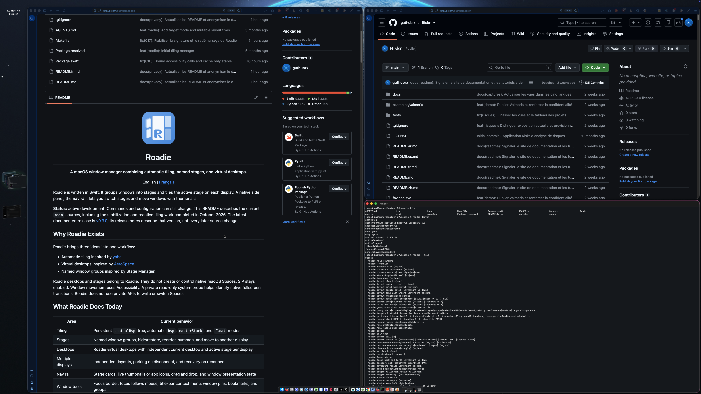
</p>

> [!TIP]
> **Mesuré sur Apple Silicon :** **`0 Mo`** et zéro timer par module éteint · **`~11–35 ms`** à chaud pour l’OCR local Apple Vision au mot exact · **`120 Hz`** ProMotion en ruban défilant · **`92/102`** vrais workflows `.alfredworkflow` complets · **SIP toujours activé** · **0 télémétrie, sans compte, gratuit**.

---

## Pourquoi Roadie ?

Sur macOS, les utilisateurs avancés finissent par entretenir **4 à 5 utilitaires séparés** qui se marchent sur les pieds : un gestionnaire de tuilage, un lanceur payant, un sélecteur `⌘ Tab`, un outil de raccourcis/gestes et un gestionnaire de presse-papiers/snippets.

Roadie réunit tout dans **un seul démon Swift local** où chaque couche partage le même contexte : le lanceur connaît tes stages et tes écrans (`safari perso gauche` ouvre Safari dans la stage *Perso* à gauche avec aperçu en direct), chaque module optionnel a son propre **interrupteur on/off dans Paramètres > Général** (`0 Mo` quand éteint), et BetterTouchTool / Karabiner restent 100 % facultatifs.

---

## Les 6 super-pouvoirs de Roadie

<table>
  <tr>
    <td width="50%" valign="top">
      <h3>🔍 OCR local Apple Vision au mot exact &amp; Recherche écran</h3>
      <p>Appuie sur <code>⌘⌃⌥F</code> et tape <b>n’importe quel mot visible à l’écran</b> — dans une conversation, une app Electron, un canvas web, un PDF scanné ou un bureau distant. Une fois activé dans <b>Paramètres &gt; Général → Modules activables</b>, ScreenCaptureKit sans ombres portées + Apple Vision local encadrent <b>pile le mot exact</b> (<code>VNRecognizedText.boundingBox</code>) : <code>⇧A</code>/<code>⇧S</code> clique directement dessus, ou <code>↓</code>/<code>↑</code> + <code>Entrée</code>. <i>Éteint par défaut : 0 capture &amp; 0 Mo de RAM.</i></p>
      <p><a href="docs/fr/launcher.md#vision-ocr">Guide OCR écran →</a></p>
    </td>
    <td width="50%" valign="top">
      <h3>📂 Saut direct dans <i>Ouvrir / Enregistrer sous</i></h3>
      <p>Dès qu’un panneau macOS <code>NSOpenPanel</code> ou <code>NSSavePanel</code> est ouvert (y compris les feuilles XPC sandboxées comme TextEdit ou Aperçu), ouvrir la barre Roadie place en #1 <b>Desktop / Bureau</b>, <b>Downloads</b>, <b>Documents</b>, tes dossiers de projets et tes récents — filtrés dès la frappe. <code>Entrée</code> téléporte la boîte de dialogue via <code>⌘⇧G</code> + Accessibilité directe <b>sans écraser le nom du fichier ni toucher au presse-papiers</b>. <i>Zéro polling.</i></p>
      <p><a href="docs/fr/launcher.md#file-dialog-jump">Guide saut dialogues →</a></p>
    </td>
  </tr>
  <tr>
    <td width="50%" valign="top">
      <h3>🪟 6 layouts, ruban Scrolling 120 Hz &amp; onglets universels ⌥</h3>
      <p>Choisis par stage : arbre persistant (<code>spatialBsp</code>), <code>bsp</code> équilibré, <code>masterStack</code>, <code>tabbed</code>, <b>ruban défilant <code>scrolling</code></b> façon Niri (glissement 120 Hz, trackpad 3/4 doigts, <code>⌥ + molette</code>, étanchéité stricte aux jointures multi-écrans) ou <code>float</code>. Maintiens <code>⌥ Option</code> sur <b>n’importe quelle tuile ou colonne</b> pour empiler en onglets, ou appelle un <b>scratchpad flottant</b> &amp; le voile <b>Dim Inactive</b>.</p>
      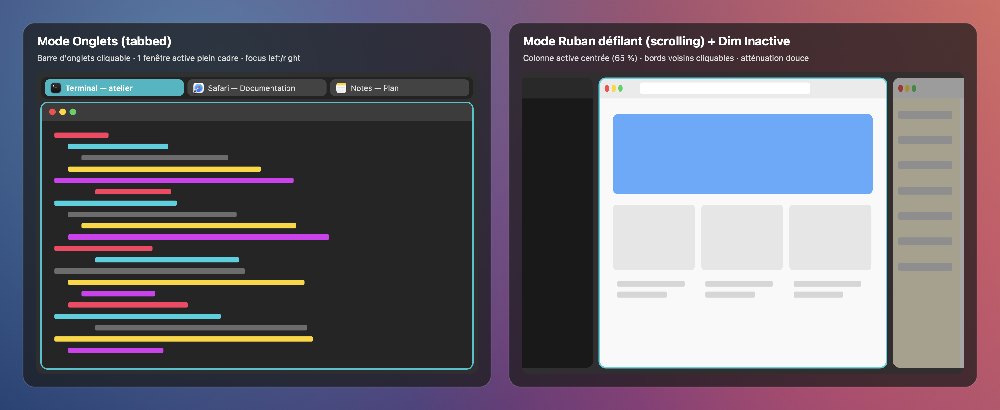
      <p><a href="docs/fr/features.md">Guide layouts &amp; gestes →</a></p>
    </td>
    <td width="50%" valign="top">
      <h3>⚡ Lanceur universel, workflows Alfred gratuits &amp; historique ↑/↓</h3>
      <p>Une seule barre (~50 ms en charge) pour apps, fenêtres, onglets ouverts, fichiers, signets, calcul &amp; convertisseur (unités, bases, fuseaux), pipette couleur native, émojis FR/EN, minuteur Pomodoro, commandes <code>/</code>, phrases (<code>safari perso gauche</code>) et <b>rappel <code>↑</code>/<code>↓</code> des 20 dernières saisies</b>. Exécute tes <b><code>.alfredworkflow</code> et thèmes Alfred gratuitement</b>, sans Powerpack.</p>
      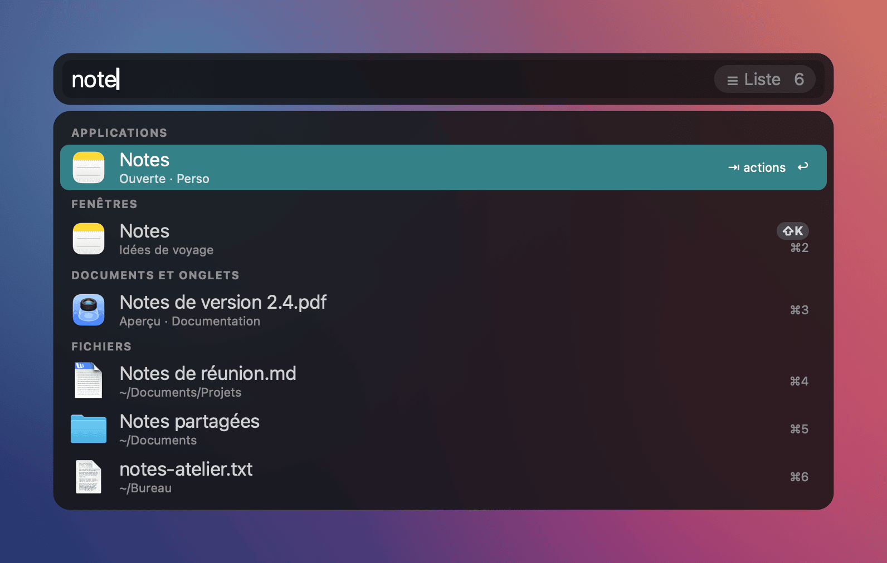
      <p><a href="docs/fr/launcher.md">Guide lanceur &amp; workflows Alfred →</a></p>
    </td>
  </tr>
  <tr>
    <td width="50%" valign="top">
      <h3>🎯 Sélecteur de zones (⌥ Tab), Sélecteur ⌘ Tab &amp; Vue d’ensemble</h3>
      <p>Sélecteur <code>⌘ Tab</code> natif (<code>CGEventTap</code>) avec touches directes <code>W/Q/M/H/S/A/D</code>, <b>Vue d’ensemble</b> par geste 4 doigts, et l’unique <b>Sélecteur de zones (<code>⌥ Tab</code>)</b> : chaque endroit cliqué devient une carte illustrée pour revenir pile sur un onglet, une cellule ou un message, même dans une autre stage.</p>
      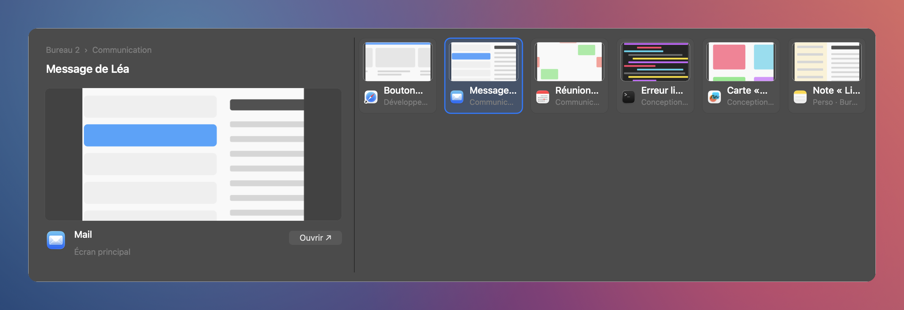
      <p><a href="docs/fr/window-switcher.md">Guide sélecteur →</a> · <a href="docs/fr/overview.md">Guide vue d’ensemble →</a></p>
    </td>
    <td width="50%" valign="top">
      <h3>🧩 Modules à coût zéro, Presse-papiers (0o600) &amp; Profils d’écrans</h3>
      <p>Un tableau de bord central <b>Modules activables</b> dans <b>Paramètres &gt; Général</b> (15 interrupteurs on/off), presse-papiers local <code>0o600</code> (ignore mots de passe &amp; gestionnaires), snippets dynamiques (<code>{date}</code>, <code>{clipboard}</code>, <code>{cursor}</code>), <b>profils matériels d’écrans</b> automatiques (<code>roadie profile</code>) et export/import JSON portable <code>roadie config export|import</code>.</p>
      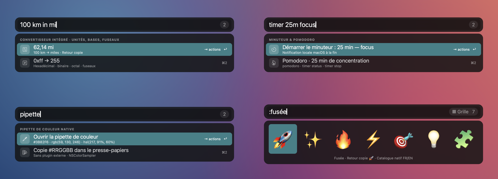
      <p><a href="docs/fr/configuration-rules.md">Guide config &amp; modules →</a></p>
    </td>
  </tr>
</table>

<details>
<summary><b>📸 Plus de captures (Verbes &amp; Phrases, Workflows &amp; Thèmes Alfred, Presse-papiers &amp; Snippets, Sélecteur &amp; Vue d’ensemble)</b></summary>

<table>
  <tr>
    <td>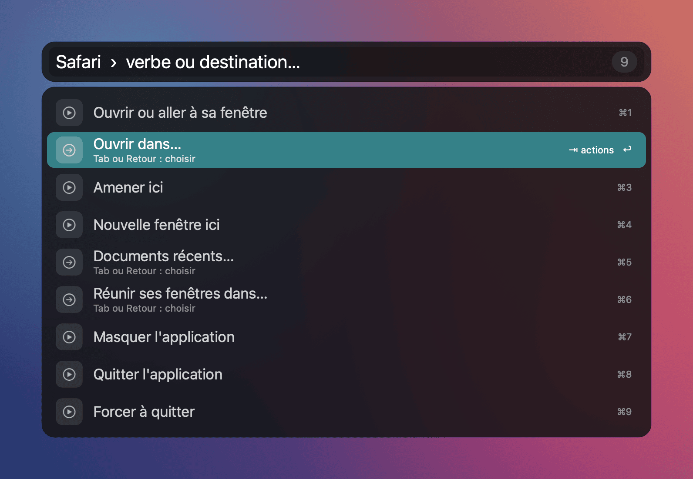</td>
    <td>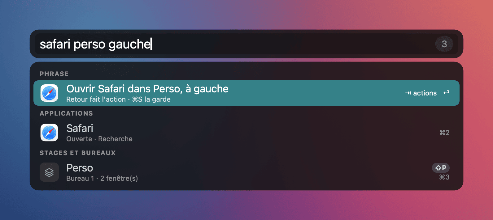</td>
  </tr>
  <tr>
    <td>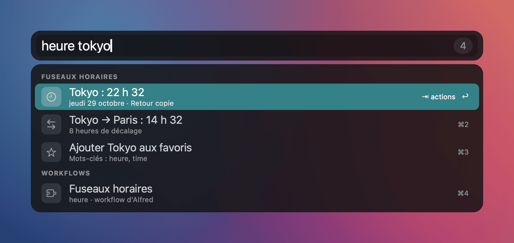</td>
    <td>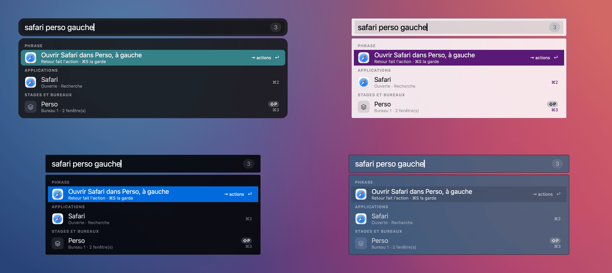</td>
  </tr>
  <tr>
    <td>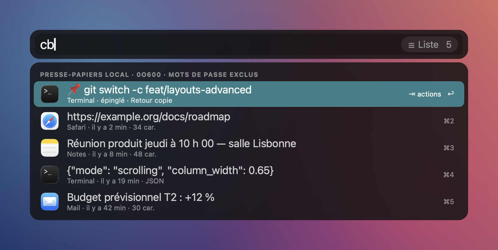</td>
    <td>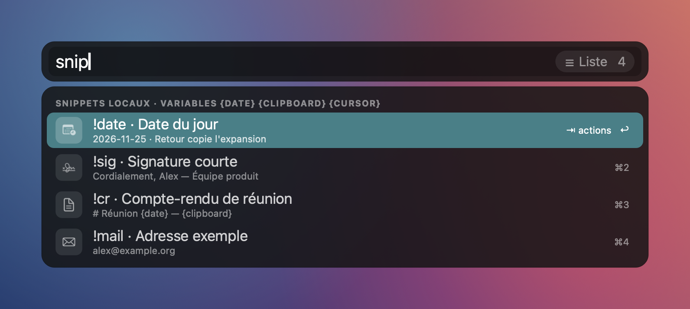</td>
  </tr>
  <tr>
    <td>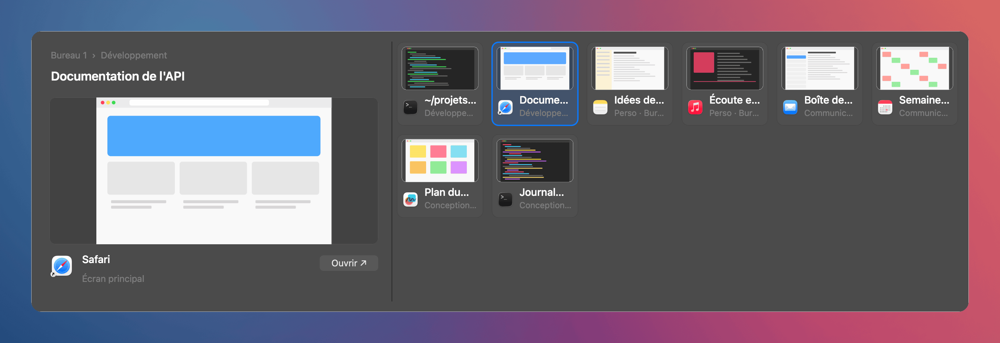</td>
    <td>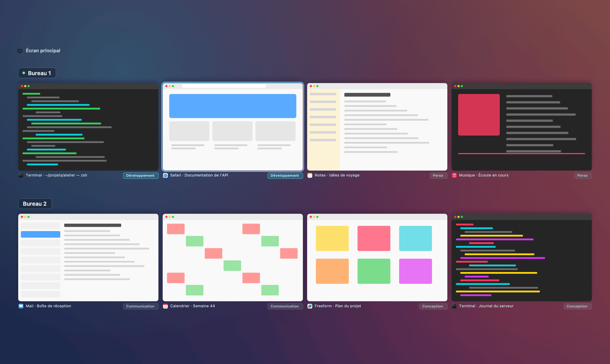</td>
  </tr>
</table>

<sub>L’interface suit la langue de macOS (français ou anglais) ou celle choisie dans Paramètres &gt; Général.</sub>

</details>

---

## Démarrage en 30 secondes

**Prérequis : macOS 14+.** Installation en une commande (télécharge le DMG officiel, vérifie le SHA-256, installe `Roadie.app` + CLI `roadie` + raccourcis autonomes AZERTY/QWERTY ; build non notarisé Apple pour l’instant, la quarantaine locale est levée à l’installation) :

```bash
# Option 1 — script 1-ligne
curl -fsSL https://raw.githubusercontent.com/guthubrx/roadie/main/scripts/install-release.sh | bash

# Option 2 — Homebrew Cask
brew install --cask Casks/roadie.rb
roadie config init --preset standard
```

Puis contrôle les permissions, la configuration et les raccourcis en un coup d’œil :

```bash
roadie onboarding                    # vérifie Accessibilité, Enregistrement d'écran, config & raccourcis
roadie shortcuts presets             # standard (flèches), vim (HJKL), minimal — sans BTT ni Karabiner
roadie shortcuts apply-preset standard
```

---

## Comparatif rapide

*Comparatif factuel (novembre 2026). Voir [le comparatif complet](docs/fr/comparison.md) pour Raycast, Alfred, AltTab et les cas où un autre outil est préférable.*

| | **Roadie** | **AeroSpace** | **yabai** | **OmniWM** | **Rift** |
|---|---|---|---|---|---|
| **SIP reste activé** | Oui | Oui | Partiel *(scripting addition)* | Oui | Oui |
| **Dispositions (layouts)** | `spatialBsp`, `bsp`, `masterStack`, `tabbed`, `scrolling`, `float` | Arbre i3, `float` | `bsp`, `stack`, `float` | `scrolling`, `dwindle` BSP, `float` | i3, `bsp`, `scrolling`, `masterStack`, `stack`, `float` |
| **Onglets par tuile / colonne** | **Tous les modes tuilés** (`⌥` + glisser, barre, CLI) | Accordion uniquement | Stack uniquement | Non | Barres sur piles |
| **Ruban défilant + gestes** | 120 Hz, trackpad 3/4 doigts, `⌥ + molette`, confinement multi-écrans | Non | Non | Oui (macOS 26+ Apple Silicon) | Oui |
| **Espaces / Rail visuel** | Stages nommées + bureaux par écran + **NavRail 3D** + Vue d’ensemble | Workspaces virtuels | Spaces natifs | Workspaces virtuels + Vue d’ensemble | Spaces natifs + Vue d’ensemble |
| **Lanceur, OCR & Saut dialogues** | **Tout intégré** *(workflows Alfred, presse-papiers `0o600`, snippets, `⌘ Tab`, zones `⌥ Tab`, OCR Vision local, saut Ouvrir/Enregistrer)* | Non | Non | Palette de commandes | Non |
| **Réglages & portabilité** | GUI temps réel + Modules + TOML + CLI + `config export` | TOML + CLI | Shell + CLI *(nécessite `skhd`)* | GUI + CLI | GUI + TOML + CLI/IPC |
| **Licence** | Apache-2.0 | MIT | MIT | GPL-2.0 | MIT (Rust) |

---

## Permissions

Roadie demande au plus deux permissions macOS — toutes deux portées par **`Roadie.app`** (`roadied`) :

| Permission | Sert à | Obligatoire ? | Si désactivée / refusée |
|---|---|---|---|
| **Accessibilité** | Lire et déplacer les fenêtres, raccourcis globaux, saut dans les dialogues fichier | **Oui** | Indispensable au tuilage et aux raccourcis |
| **Enregistrement d’écran** | Miniatures live dans le rail/vue d’ensemble & OCR local Apple Vision (optionnel) | **Facultative** | Le rail affiche les icônes d’apps ; l’OCR reste inactif (`0` capture, `0 Mo`) |

### La commande `roadie` n’a besoin d’aucune permission

Quand `roadied` tourne, `roadie` lui transmet tes demandes par un socket Unix local (`~/.roadies/roadied.sock`). Le démon exécute l’action avec ses propres permissions : BetterTouchTool, Karabiner, `skhd` ou un script shell n’ont donc besoin **d’aucune permission Accessibilité** et ne re-scannent pas les fenêtres à chaque touche. *(Si le démon est arrêté, `roadie` s’exécute localement ; `daemon`, `doctor`, `permissions` et `config validate` tournent toujours en local. L’état est publié dans `~/.roadies/daemon-status.json`.)*

## Confidentialité

- **100 % local, zéro télémétrie, sans compte** : aucun service d’analyse ni d’envoi distant n’existe dans le code source. Le seul appel réseau optionnel est la commande manuelle `roadie update check` (qui ne télécharge ni n’installe rien automatiquement).
- **Cloisonnement strict** : l’historique du presse-papiers réside dans `~/.roadies/clipboard.json` avec permissions POSIX `0o600`, n’écrit jamais son contenu dans `events.jsonl` et exclut automatiquement `ConcealedType` / `TransientType` / `AutoGeneratedType` ainsi que les gestionnaires de mots de passe (1Password, Bitwarden, KeePassXC, Trousseau d’accès, LastPass, Dashlane). L’auto-expansion clavier des snippets est éteinte par défaut et toujours suspendue dans les champs de mot de passe macOS.
- **Modules optionnels à coût zéro** : l’OCR (`ocr_fallback`), les profils d’écrans (`display_profiles_enabled`), Dim Inactive et l’auto-expansion de snippets valent `false` par défaut (zéro timer, zéro capture, `0 Mo` de RAM supplémentaire).
- **Données locales privées** : l’état local, les journaux (`~/.roadies/`), les macros et captures peuvent contenir des titres ou positions de fenêtres — relis et anonymise avant de partager une issue.

---

## Documentation

Guides complets en **français** ([index](docs/fr/README.md)) et en **anglais** ([index](docs/en/README.md)) :

| Sujet | Français | English |
|---|---|---|
| Référence complète (layouts, NavRail, zones, modules) | [features.md](docs/fr/features.md) | [features.md](docs/en/features.md) |
| Lanceur, workflows Alfred, OCR Vision & Saut dialogues | [launcher.md](docs/fr/launcher.md) | [launcher.md](docs/en/launcher.md) |
| Sélecteur de fenêtres (`⌘ Tab`) & profils | [window-switcher.md](docs/fr/window-switcher.md) | [window-switcher.md](docs/en/window-switcher.md) |
| Vue d’ensemble & gestes 4 doigts | [overview.md](docs/fr/overview.md) | [overview.md](docs/en/overview.md) |
| Référence CLI complète (`stage`, `desktop`, `profile`, `config`…) | [cli.md](docs/fr/cli.md) | [cli.md](docs/en/cli.md) |
| Configuration (`roadies.toml`), règles & effets | [configuration-rules.md](docs/fr/configuration-rules.md) | [configuration-rules.md](docs/en/configuration-rules.md) |
| Événements & API JSON Query | [events-query.md](docs/fr/events-query.md) | [events-query.md](docs/en/events-query.md) |
| Comparatif vs AeroSpace, yabai, OmniWM, Rift, Raycast, Alfred, AltTab | [comparison.md](docs/fr/comparison.md) | [comparison.md](docs/en/comparison.md) |
| Cas d’usage quotidiens & notes de release | [use-cases.md](docs/fr/use-cases.md) · [v0.14.0](docs/releases/v0.14.0.md) | [use-cases.md](docs/en/use-cases.md) · [v0.14.0](docs/releases/v0.14.0.en.md) |

---

## Référence technique & développement

<a id="installation-manuelle"></a>
<details>
<summary><b>🛠️ Compilation depuis les sources, installation manuelle, signature, DMG &amp; désinstallation</b></summary>

### Prérequis
- macOS 14+, Xcode Command Line Tools (`xcode-select --install` ; Xcode complet inutile).
- Optionnels : `tmux` (dev/runtime modulaire), `create-dmg` (`brew install create-dmg` pour `make dmg`).

### Installation manuelle (build Release + LaunchAgent)
```bash
make install          # build release -> ~/Applications/Roadie.app, ~/.local/bin/roadie{,d}, LaunchAgent
make restart          # recharge le LaunchAgent installé (ne lance jamais tmux)
roadie query health
```
Ajoute `~/.local/bin` à ton `PATH`. Pour installer sans démarrer le LaunchAgent : `ROADIE_INSTALL_NO_START=1 make install`.

### Signature du code et permissions
macOS lie la permission Accessibilité à la signature de l’application. `make install` reprend l’empreinte exacte du certificat déjà installé (ou `roadied-cert` à la première installation, sinon signature ad hoc avec avertissement). Surcharge explicite :
```bash
security find-identity -v -p codesigning
ROADIE_CODESIGN_IDENTITY="Apple Development: Ton Nom (TEAMID)" make install
```

### Développement &amp; runtime modulaire
```bash
make test             # suite complète (utiliser ./scripts/test --no-parallel sous charge)
make dev-start        # build debug dans ./bin, décharge le LaunchAgent, lance dans tmux
./scripts/start-modular && roadie query components
```
*Un seul démon à la fois (`~/.roadies/roadied.lock`) : lance `make stop` avant de basculer entre `dev-start` et `make restart`.*

### Build DMG &amp; installation non notarisée Apple
```bash
make dmg              # génère dist/Roadie.dmg (signé ad-hoc, non notarisé Apple)
```
Glisse `Roadie.app` dans `/Applications`. Si Gatekeeper bloque le premier lancement, ouvre **Réglages Système > Confidentialité et sécurité → Ouvrir quand même**, puis accorde Accessibilité (et Enregistrement d’écran en option). [Procédure Apple](https://support.apple.com/en-us/102445).

### Désinstallation
```bash
make uninstall
```
Réaffiche toutes les fenêtres (`roadie restore unhide-all`), arrête le démon, supprime le LaunchAgent, `~/Applications/Roadie.app` et `~/.local/bin/roadie*`. Ne supprime jamais `~/.config/roadies`.

</details>

<details>
<summary><b>⌨️ Mémo CLI quotidien &amp; bases de configuration</b></summary>

La configuration vit dans `~/.config/roadies/roadies.toml` (modèle commenté : [`examples/roadies.toml`](examples/roadies.toml) ; exemples `skhd`/`Karabiner` dans `examples/`).

```bash
# Modes, navigation, onglets & scratchpad
roadie mode spatialBsp|bsp|masterStack|tabbed|scrolling|float
roadie focus left|right|back-and-forth && roadie move left && roadie warp right
roadie tab next|prev|stack|unstack|move
roadie scratchpad assign notes && roadie scratchpad toggle notes

# Stages, bureaux virtuels & écrans
roadie stage list|create|rename|switch|assign|move-to-display|prune-empty
roadie desktop list|focus|label|move && roadie display swap right

# Outils du lanceur, profils & export portable
roadie clipboard list && roadie snippet expand !sig --copy && roadie timer pomodoro
roadie project save Dev --url https://example.org --app com.apple.Terminal --note "Sprint"
roadie profile save bureau && roadie config export ~/roadie-backup.json
roadie config import ~/roadie-backup.json --dry-run

# Automatisation, placement ponctuel silencieux, grilles & API Query
roadie rules add-once --bundle-id com.google.Chrome --display 1 --stage-position 1 --no-follow --ttl 30
roadie stage assign --window <ID> --display 1 --stage-position 1 --no-follow
roadie query state|windows|displays|desktops|stages|groups|rules|health|events
roadie events subscribe --from-now --initial-state
roadie targets search && roadie grid interactive --scope display
```

Référence complète : [Commandes CLI](docs/fr/cli.md) · [Configuration & règles](docs/fr/configuration-rules.md).

</details>

<details>
<summary><b>🩺 Dépannage &amp; organisation du dépôt</b></summary>

```bash
roadie onboarding             # bilan permissions, config, raccourcis
roadie doctor                 # diagnostic complet daemon, permissions & config
roadie query health && roadie state audit && roadie self-test
roadie state heal && roadie daemon heal
roadie restore unhide-all     # ramène toute fenêtre masquée ou hors écran
make logs && roadie events tail 50
roadied --version
```
Les journaux précédents restent dans `~/.roadies/roadied.stdout.log.1` et `~/.roadies/roadied.stderr.log.1`. Si les fenêtres cessent de bouger après une recompilation, vérifie Accessibilité pour `~/Applications/Roadie.app` puis `make restart`. Un processus de surveillance réaffiche les fenêtres automatiquement en cas de crash (`roadied run --yes --no-restore-safety` pour le désactiver).

```text
Sources/RoadieAX       Snapshots système et Accessibilité
Sources/RoadieCore     Types partagés, géométrie, configuration
Sources/RoadieTiler    Stratégies de layout pures
Sources/RoadieStages   État persistant desktops et stages Roadie
Sources/RoadieDaemon   Services daemon, rail, lanceur, OCR, bordure, commandes
Sources/roadie         CLI
Sources/roadied        Point d’entrée daemon
Tests                  Tests unitaires
scripts                Helpers build, test, release et runtime
examples               Config d’exemple, raccourcis skhd et Karabiner
```

</details>

---

## Licence

Distribué sous licence [Apache-2.0](LICENSE). Les notices des dépendances figurent dans [THIRD_PARTY_NOTICES](THIRD_PARTY_NOTICES). Suis [CHANGELOG.md](CHANGELOG.md) et les [releases](https://github.com/guthubrx/roadie/releases) pour les évolutions sur `main`.

Copyright 2026 guthubrx.
