<div align="center">


# Roadie

**The all-in-one native macOS workspace engine: automatic tiling & 120 Hz scrolling ribbon, universal launcher with free Alfred workflows, word-level local Vision OCR, and direct Open/Save dialog jump — in one Swift binary.**

[](https://github.com/guthubrx/roadie/releases/tag/v0.14.0)
[](Package.swift)
[](LICENSE)
[](#privacy)

**English** · [Français](README.fr.md)

<p>
  <a href="#standout-capabilities">Standout capabilities</a> •
  <a href="#quick-start">Quick start</a> •
  <a href="#how-roadie-compares">Compare</a> •
  <a href="#permissions">Permissions & Privacy</a> •
  <a href="#documentation">Documentation</a> •
  <a href="https://github.com/guthubrx/roadie/releases/tag/v0.14.0">Download v0.14.0</a>
</p>

</div>

<p align="center">
  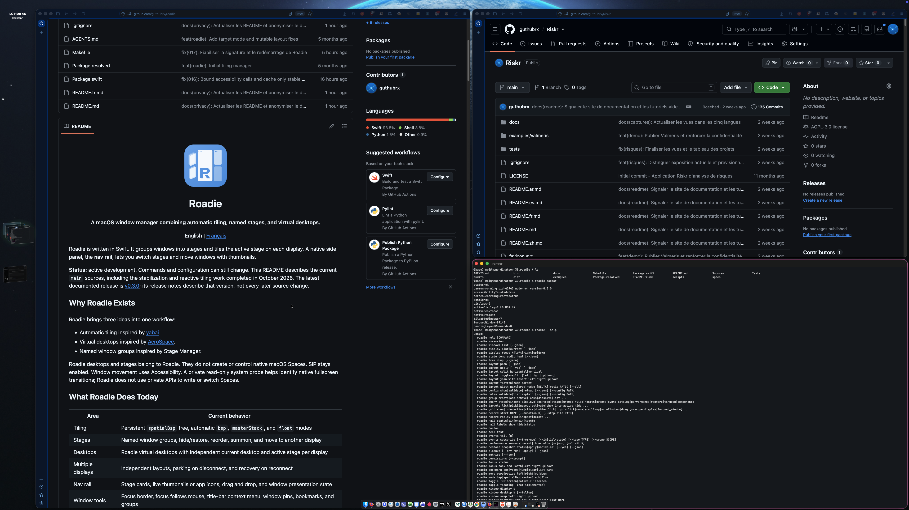
</p>

> [!TIP]
> **Measured on Apple Silicon:** **`0 MB`** & zero timers for every disabled module · **`~11–35 ms`** warm word-level Apple Vision OCR · **`120 Hz`** ProMotion scrolling ribbon · **`92/102`** real `.alfredworkflow` packages run complete · **SIP always ON** · **zero telemetry, no account, free**.

---

## Why Roadie?

On macOS, power users end up maintaining **4 to 5 separate apps** that fight each other — a tiling window manager, a paid launcher, a `⌘ Tab` switcher, a hotkey/gesture daemon, and a clipboard/snippet utility.

Roadie unifies them into **one local Swift daemon** where every layer shares context: the launcher knows your stages and displays (`safari personal left` opens Safari directly in the *Personal* stage on the left with a live preview), every optional capability has its own **on/off switch in Settings > General** (`0 MB` when off), and BetterTouchTool / Karabiner remain 100% optional.

---

## Standout capabilities

<table>
  <tr>
    <td width="50%" valign="top">
      <h3>🔍 Word-Level Local Apple Vision OCR &amp; On-Screen Search</h3>
      <p>Press <code>⌘⌃⌥F</code> and type <b>any word visible on screen</b> — inside chats, Electron apps, web canvases, scanned PDFs, or remote desktops. When enabled in <b>Settings &gt; General → Toggleable modules</b>, shadowless ScreenCaptureKit + local Apple Vision highlights <b>the exact word</b> (<code>VNRecognizedText.boundingBox</code>): press <code>⇧A</code>/<code>⇧S</code> to click straight on it, or <code>↓</code>/<code>↑</code> + <code>Return</code>. <i>Off by default: 0 captures &amp; 0 MB RAM.</i></p>
      <p><a href="docs/en/launcher.md#vision-ocr">On-screen OCR guide →</a></p>
    </td>
    <td width="50%" valign="top">
      <h3>📂 Direct Open / Save File Dialog Jump</h3>
      <p>Whenever a macOS <code>NSOpenPanel</code> or <code>NSSavePanel</code> is open (including sandboxed XPC sheets like TextEdit or Preview), opening Roadie's bar puts <b>Desktop</b>, <b>Downloads</b>, <b>Documents</b>, project folders, and recent folders at #1 — and filters them live as you type. Press <code>Return</code> to teleport the dialog via <code>⌘⇧G</code> + direct Accessibility write <b>without losing your filename or touching your clipboard</b>. <i>Zero polling.</i></p>
      <p><a href="docs/en/launcher.md#file-dialog-jump">File dialog jump guide →</a></p>
    </td>
  </tr>
  <tr>
    <td width="50%" valign="top">
      <h3>🪟 6 Layouts, 120 Hz Scrolling Ribbon &amp; Universal ⌥ Tabs</h3>
      <p>Pick per stage: persistent tree (<code>spatialBsp</code>), balanced <code>bsp</code>, <code>masterStack</code>, floating <code>tabbed</code>, Niri-inspired <b><code>scrolling</code> ribbon</b> (120 Hz spring glide, 3/4-finger swipe, <code>⌥ + scroll</code>, strict multi-display seam clipping), or <code>float</code>. Hold <code>⌥ Option</code> over <b>any tile or column</b> to stack windows as tabs, drag tabs to reorder or detach, or summon a centered <b>floating scratchpad</b> &amp; <b>Dim Inactive</b> veil.</p>
      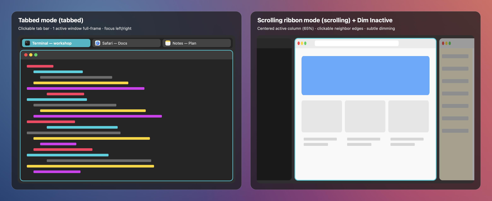
      <p><a href="docs/en/features.md">Layouts &amp; gestures guide →</a></p>
    </td>
    <td width="50%" valign="top">
      <h3>⚡ Universal Launcher, Free Alfred Workflows &amp; ↑/↓ History</h3>
      <p>One bar (~50 ms under load) for apps, windows, open tabs, files, bookmarks, calculator &amp; unit/base/timezone converter, native color picker, EN/FR emojis, Pomodoro timer, <code>/commands</code>, phrases (<code>safari personal left</code>), and <b><code>↑</code>/<code>↓</code> recall of your last 20 queries</b>. Runs existing <b><code>.alfredworkflow</code> files and Alfred themes for free</b> — no Powerpack needed.</p>
      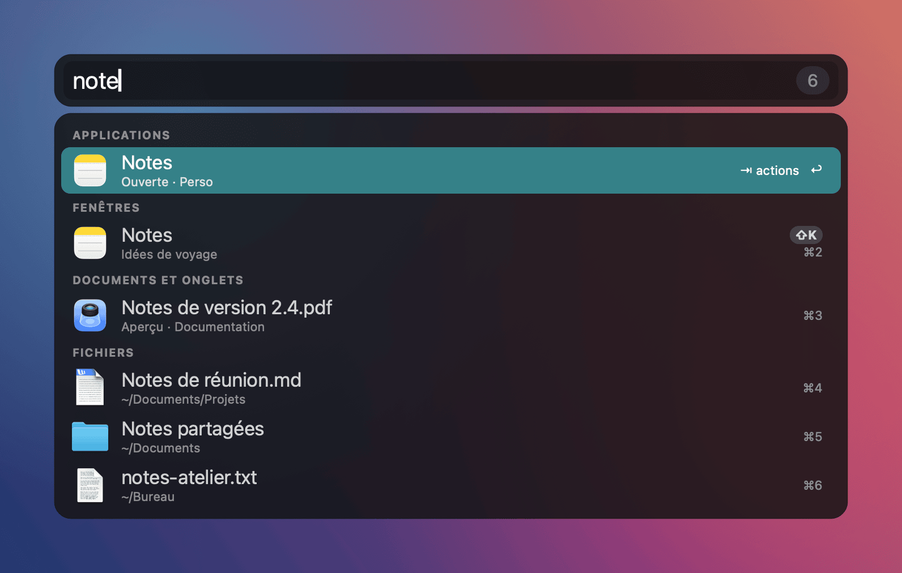
      <p><a href="docs/en/launcher.md">Launcher &amp; Alfred workflows guide →</a></p>
    </td>
  </tr>
  <tr>
    <td width="50%" valign="top">
      <h3>🎯 Clicked-Zone Switcher (⌥ Tab), ⌘ Tab Switcher &amp; Overview</h3>
      <p>Native <code>CGEventTap</code> <code>⌘ Tab</code> switcher with direct <code>W/Q/M/H/S/A/D</code> keys, 4-finger swipe <b>Global Overview</b>, and the unique <b>Zone Switcher (<code>⌥ Tab</code>)</b>: every place you click becomes a snapshotted card so you can bounce back to an exact tab, cell, or message across stages and desktops.</p>
      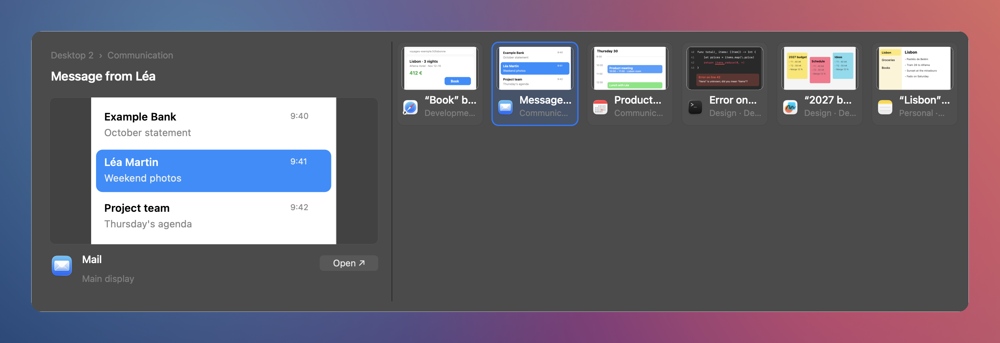
      <p><a href="docs/en/window-switcher.md">Switcher guide →</a> · <a href="docs/en/overview.md">Overview guide →</a></p>
    </td>
    <td width="50%" valign="top">
      <h3>🧩 Zero-Cost Toggleable Modules, Clipboard (0o600) &amp; Profiles</h3>
      <p>One central <b>Toggleable modules</b> dashboard in <b>Settings &gt; General</b> (15 on/off switches), <code>0o600</code> local clipboard history (auto-skips password managers &amp; concealed fields), dynamic snippets (<code>{date}</code>, <code>{clipboard}</code>, <code>{cursor}</code>), automatic monitor-topology <b>display profiles</b> (<code>roadie profile</code>), and portable JSON <code>roadie config export|import</code>.</p>
      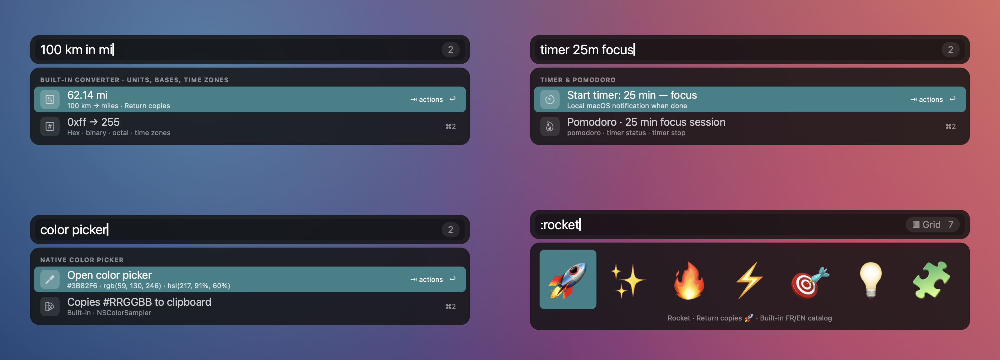
      <p><a href="docs/en/configuration-rules.md">Configuration &amp; modules guide →</a></p>
    </td>
  </tr>
</table>

<details>
<summary><b>📸 More screenshots (Verbs &amp; Phrases, Alfred Workflows &amp; Themes, Clipboard &amp; Snippets, Window Switcher &amp; Overview)</b></summary>

<table>
  <tr>
    <td>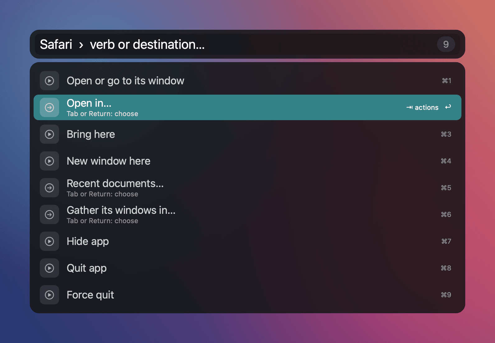</td>
    <td>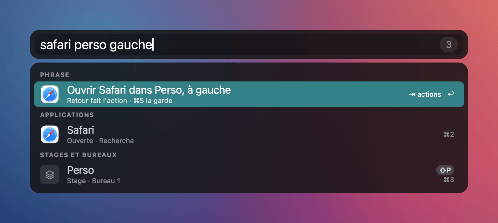</td>
  </tr>
  <tr>
    <td>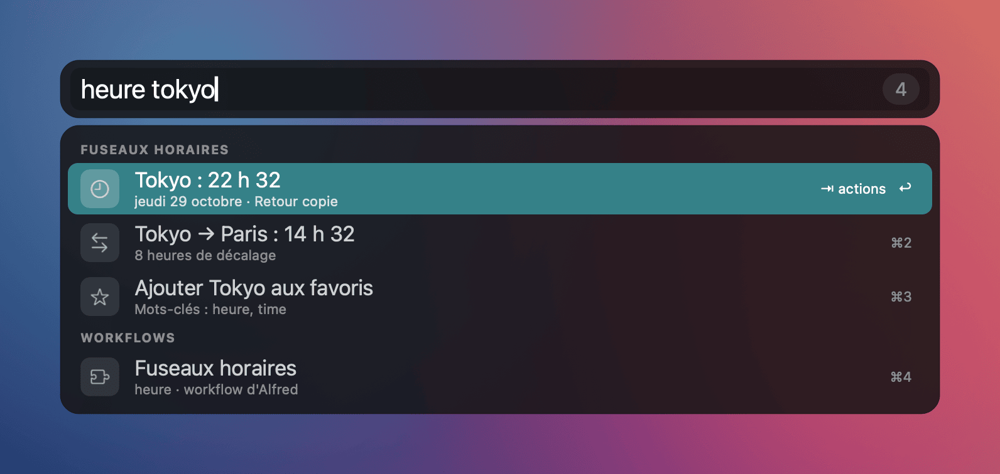</td>
    <td>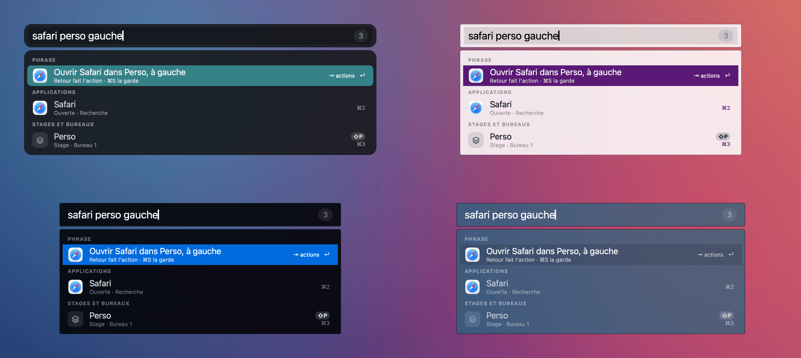</td>
  </tr>
  <tr>
    <td>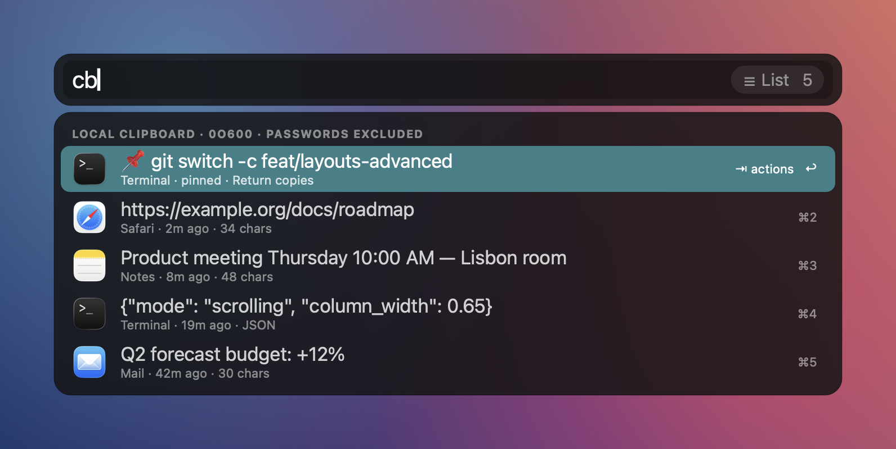</td>
    <td>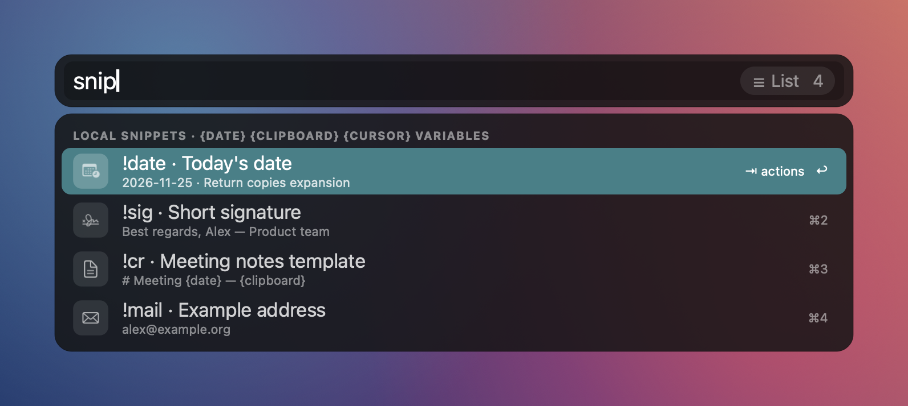</td>
  </tr>
  <tr>
    <td>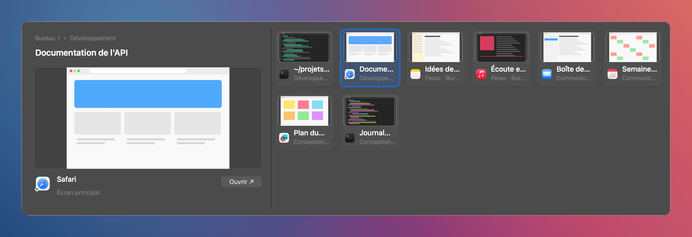</td>
    <td>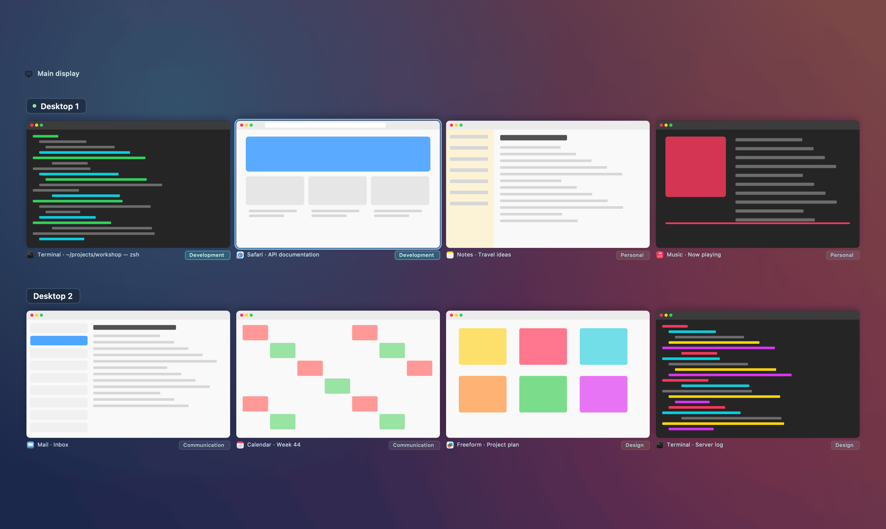</td>
  </tr>
</table>

<sub>Interface follows macOS language (English or French) or the language chosen in Settings &gt; General.</sub>

</details>

---

## Quick start

**Requires macOS 14+.** Install in one command (downloads the official DMG, verifies SHA-256, installs `Roadie.app` + `roadie` CLI + autonomous QWERTY/AZERTY shortcuts; builds are not Apple-notarized yet and local quarantine is cleared on install):

```bash
# Option 1 — one-line installer
curl -fsSL https://raw.githubusercontent.com/guthubrx/roadie/main/scripts/install-release.sh | bash

# Option 2 — Homebrew Cask
brew install --cask Casks/roadie.rb
roadie config init --preset standard
```

Then verify permissions, configuration, and shortcuts in one glance:

```bash
roadie onboarding                    # checks daemon Accessibility, Screen Recording, config & shortcuts
roadie shortcuts presets             # standard (arrows), vim (HJKL), minimal — no BTT or Karabiner needed
roadie shortcuts apply-preset standard
```

---

## How Roadie compares

*Factual snapshot (November 2026). See [the full comparison](docs/en/comparison.md) for Raycast, Alfred, AltTab, and when another tool is a better fit.*

| | **Roadie** | **AeroSpace** | **yabai** | **OmniWM** | **Rift** |
|---|---|---|---|---|---|
| **Keeps SIP enabled** | Yes | Yes | Partial *(scripting addition)* | Yes | Yes |
| **Layouts** | `spatialBsp`, `bsp`, `masterStack`, `tabbed`, `scrolling`, `float` | i3 tree, `float` | `bsp`, `stack`, `float` | `scrolling`, `dwindle` BSP, `float` | i3, `bsp`, `scrolling`, `masterStack`, `stack`, `float` |
| **Per-tile / per-column tabs** | **All slotted tiled modes** (`⌥` + drag, tab bar, CLI) | Accordion only | Stack only | No | Tab bars on stacks |
| **Scrolling ribbon + gestures** | 120 Hz, 3/4-finger swipe, `⌥ + scroll`, multi-display clipping | No | No | Yes (macOS 26+ Apple Silicon) | Yes |
| **Workspaces / Visual rail** | Named stages + per-display desktops + **3D NavRail** + Overview | Virtual workspaces | Native Spaces | Virtual workspaces + Overview | Native Spaces + Overview |
| **Launcher, OCR & Dialog Jump** | **All built-in** *(Alfred workflows, `0o600` clipboard, snippets, `⌘ Tab`, `⌥ Tab` zones, local Vision OCR, Open/Save jump)* | No | No | Command palette | No |
| **Settings & portability** | Live GUI + Modules dashboard + TOML + CLI + `config export` | TOML + CLI | Shell + CLI *(needs `skhd`)* | GUI + CLI | GUI + TOML + CLI/IPC |
| **License** | Apache-2.0 | MIT | MIT | GPL-2.0 | MIT (Rust) |

---

## Permissions

Roadie asks for at most two macOS permissions — both belong to **`Roadie.app`** (`roadied`):

| Permission | Used for | Required? | When disabled / revoked |
|---|---|---|---|
| **Accessibility** | Reading and moving windows, global hotkeys, Open/Save dialog jump | **Yes** | Core window tiling & launcher shortcuts require it |
| **Screen Recording** | Live thumbnails in the rail/overview & opt-in local Apple Vision OCR | **Optional** | Rail shows app icons; OCR stays off (`0` captures, `0 MB`) |

### The `roadie` CLI needs no permission

When `roadied` runs, `roadie` sends requests over a local Unix socket (`~/.roadies/roadied.sock`). The daemon performs the work with its own permissions, so BetterTouchTool, Karabiner, `skhd`, or shell scripts calling `roadie` need **no Accessibility permission** and pay no per-keypress window scan cost. *(If the daemon is stopped, `roadie` falls back to running locally; `daemon`, `doctor`, `permissions`, and `config validate` always run locally. Status is published to `~/.roadies/daemon-status.json`.)*

## Privacy

- **100% local, zero telemetry, no account**: no remote analytics or upload service exists in the sources. The only optional network call is manual `roadie update check` (which never downloads or installs anything automatically).
- **Strict local boundaries**: clipboard history lives in `~/.roadies/clipboard.json` with `0o600` POSIX permissions, never logs content to `events.jsonl`, and automatically skips `ConcealedType` / `TransientType` / `AutoGeneratedType` and password managers (1Password, Bitwarden, KeePassXC, Keychain Access, LastPass, Dashlane). Optional snippet auto-expansion is off by default and always skips macOS secure text input.
- **Zero-cost opt-in modules**: OCR (`ocr_fallback`), display profiles (`display_profiles_enabled`), Dim Inactive, and snippet auto-expand default to `false` (zero timers, zero captures, `0 MB` extra RAM).
- **Private runtime data**: local state, logs (`~/.roadies/`), macros, and desktop screenshots can contain window titles or positions — review and redact them before sharing an issue.

---

## Documentation

Full guides in **English** ([index](docs/en/README.md)) and **French** ([index](docs/fr/README.md)):

| Topic | English | Français |
|---|---|---|
| Full feature reference (layouts, NavRail, zones, modules) | [features.md](docs/en/features.md) | [features.md](docs/fr/features.md) |
| Launcher, Alfred workflows, Vision OCR & File Dialog Jump | [launcher.md](docs/en/launcher.md) | [launcher.md](docs/fr/launcher.md) |
| Window switcher (`⌘ Tab`) & profiles | [window-switcher.md](docs/en/window-switcher.md) | [window-switcher.md](docs/fr/window-switcher.md) |
| Global overview & 4-finger gestures | [overview.md](docs/en/overview.md) | [overview.md](docs/fr/overview.md) |
| Complete CLI reference (`stage`, `desktop`, `profile`, `config`…) | [cli.md](docs/en/cli.md) | [cli.md](docs/fr/cli.md) |
| Configuration (`roadies.toml`), rules & effects | [configuration-rules.md](docs/en/configuration-rules.md) | [configuration-rules.md](docs/fr/configuration-rules.md) |
| Events & JSON Query API | [events-query.md](docs/en/events-query.md) | [events-query.md](docs/fr/events-query.md) |
| Comparison vs AeroSpace, yabai, OmniWM, Rift, Raycast, Alfred, AltTab | [comparison.md](docs/en/comparison.md) | [comparison.md](docs/fr/comparison.md) |
| Everyday use cases & release notes | [use-cases.md](docs/en/use-cases.md) · [v0.14.0](docs/releases/v0.14.0.en.md) | [use-cases.md](docs/fr/use-cases.md) · [v0.14.0](docs/releases/v0.14.0.md) |

---

## Technical reference & development

<a id="manual-installation"></a>
<details>
<summary><b>🛠️ Build from source, manual installation, code signing, DMG &amp; uninstall</b></summary>

### Prerequisites
- macOS 14+, Xcode Command Line Tools (`xcode-select --install`; full Xcode not required).
- Optional: `tmux` (dev/modular runtime), `create-dmg` (`brew install create-dmg` for `make dmg`).

### Manual install (release build + LaunchAgent)
```bash
make install          # release build -> ~/Applications/Roadie.app, ~/.local/bin/roadie{,d}, LaunchAgent
make restart          # reloads the installed LaunchAgent (never starts tmux)
roadie query health
```
Add `~/.local/bin` to your `PATH`. To install without starting LaunchAgent: `ROADIE_INSTALL_NO_START=1 make install`.

### Code signing and permissions
macOS ties Accessibility permission to the app's code signature. `make install` reuses the exact certificate fingerprint of the installed app (or `roadied-cert` on first install, falling back to ad-hoc with a warning). Override explicitly with:
```bash
security find-identity -v -p codesigning
ROADIE_CODESIGN_IDENTITY="Apple Development: Your Name (TEAMID)" make install
```

### Development run &amp; modular runtime
```bash
make test             # full test suite (use ./scripts/test --no-parallel under heavy load)
make dev-start        # debug build into ./bin, unloads LaunchAgent, runs in tmux
./scripts/start-modular && roadie query components
```
*One daemon at a time (`~/.roadies/roadied.lock`): run `make stop` before switching between `dev-start` and `make restart`.*

### DMG build &amp; unsigned installation
```bash
make dmg              # outputs dist/Roadie.dmg (ad-hoc signed, not Apple-notarized)
```
Drag `Roadie.app` to `/Applications`. If Gatekeeper blocks first launch, open **System Settings > Privacy & Security → Open Anyway**, then grant Accessibility (and optional Screen Recording). [Apple instructions](https://support.apple.com/en-us/102445).

### Uninstall
```bash
make uninstall
```
Unhides all windows (`roadie restore unhide-all`), stops the daemon, removes the LaunchAgent, `~/Applications/Roadie.app`, and `~/.local/bin/roadie*`. Never deletes `~/.config/roadies`.

</details>

<details>
<summary><b>⌨️ Daily CLI cheat sheet &amp; configuration basics</b></summary>

Config lives in `~/.config/roadies/roadies.toml` (commented template: [`examples/roadies.toml`](examples/roadies.toml); `skhd`/`Karabiner` examples in `examples/`).

```bash
# Modes, navigation, tabs & scratchpad
roadie mode spatialBsp|bsp|masterStack|tabbed|scrolling|float
roadie focus left|right|back-and-forth && roadie move left && roadie warp right
roadie tab next|prev|stack|unstack|move
roadie scratchpad assign notes && roadie scratchpad toggle notes

# Stages, desktops & displays
roadie stage list|create|rename|switch|assign|move-to-display|prune-empty
roadie desktop list|focus|label|move && roadie display swap right

# Launcher tools, profiles & portable export
roadie clipboard list && roadie snippet expand !sig --copy && roadie timer pomodoro
roadie project save Dev --url https://example.org --app com.apple.Terminal --note "Sprint"
roadie profile save desk && roadie config export ~/roadie-backup.json
roadie config import ~/roadie-backup.json --dry-run

# Automation, grids & query API
roadie query state|windows|displays|desktops|stages|groups|rules|health|events
roadie events subscribe --from-now --initial-state
roadie targets search && roadie grid interactive --scope display
```

Full reference: [CLI commands](docs/en/cli.md) · [Configuration & rules](docs/en/configuration-rules.md).

</details>

<details>
<summary><b>🩺 Troubleshooting &amp; repository layout</b></summary>

```bash
roadie onboarding             # permissions, config, shortcuts checklist
roadie doctor                 # full daemon, permissions & config diagnostic
roadie query health && roadie state audit && roadie self-test
roadie state heal && roadie daemon heal
roadie restore unhide-all     # bring back any hidden/off-screen windows
make logs && roadie events tail 50
roadied --version
```
Previous run logs stay in `~/.roadies/roadied.stdout.log.1` and `~/.roadies/roadied.stderr.log.1`. If windows stop moving after a rebuild, check Accessibility for `~/Applications/Roadie.app` and run `make restart`. A watcher restores hidden windows automatically on crash (disable with `roadied run --yes --no-restore-safety`).

```text
Sources/RoadieAX       Accessibility and system window snapshots
Sources/RoadieCore     Shared types, geometry, config
Sources/RoadieTiler    Pure layout strategies
Sources/RoadieStages   Persistent Roadie desktop and stage state
Sources/RoadieDaemon   Daemon services, rail, launcher, OCR, border, commands
Sources/roadie         CLI
Sources/roadied        Daemon entry point
Tests                  Unit tests
scripts                Build, test, release, and runtime helpers
examples               Example config, skhd and Karabiner shortcuts
```

</details>

---

## License

Licensed under [Apache-2.0](LICENSE). Dependency notices are in [THIRD_PARTY_NOTICES](THIRD_PARTY_NOTICES). Follow [CHANGELOG.md](CHANGELOG.md) and [releases](https://github.com/guthubrx/roadie/releases) for ongoing updates on `main`.

Copyright 2026 guthubrx.
