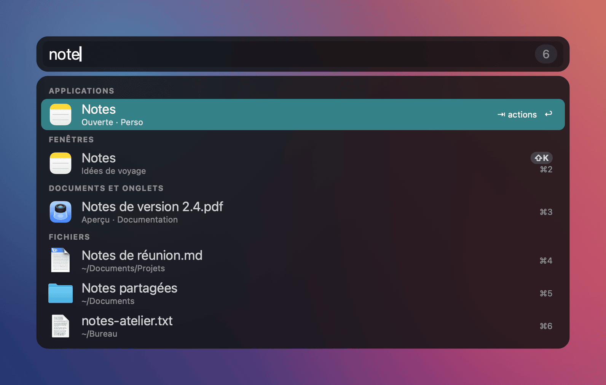
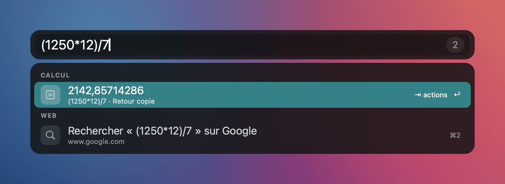
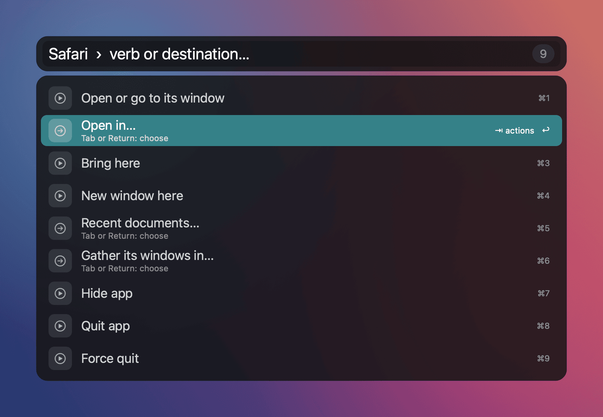
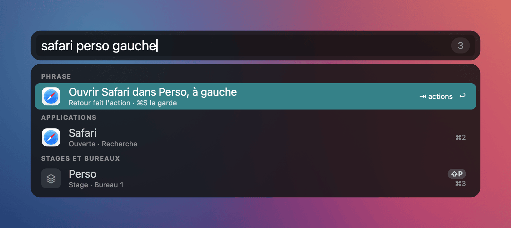
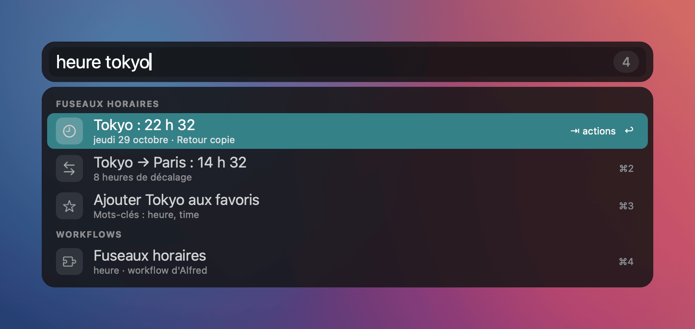
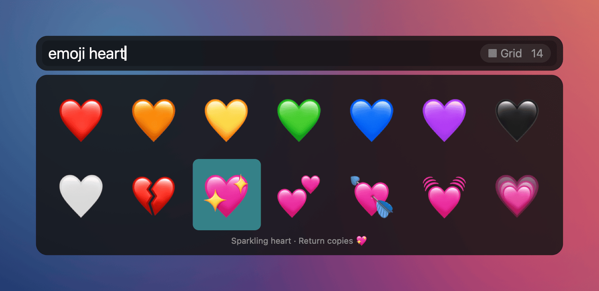
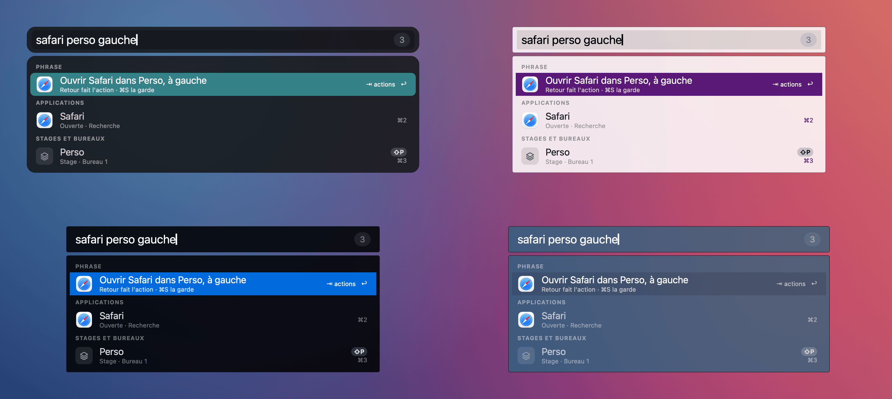
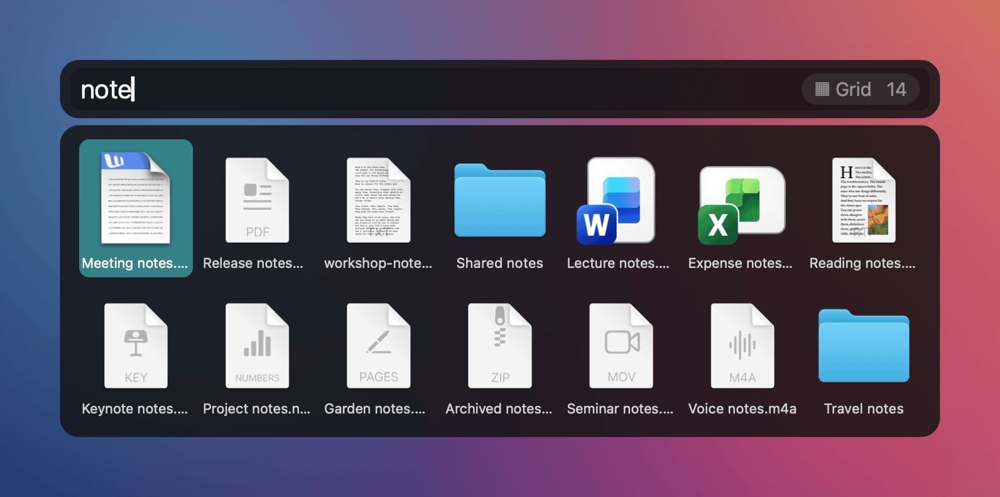

# Launcher and Alfred workflows

[Français](../fr/launcher.md) · [Documentation](README.md)

Roadie's bar is a full launcher, running in the same process as the window manager. It finds and opens apps,
windows, files and web pages. It also knows where to put what it opens: which stage, which desktop, which side of
the screen. It runs Alfred workflows (`.alfredworkflow` files) without Alfred and without the Powerpack.

> Available in `main`; the published 0.10.0 release does not include the launcher yet. It will ship in the next
> release. Until then, [build from source](../../README.md#build-and-development-run).

The bar follows the macOS language (English, or French on a Mac set to French), or the language chosen in
Settings > General > Interface language. What you type works in both languages. The screenshots in this guide are drawn by Roadie's renderer with sample windows and files.

## Open the bar

- Shortcut: ⌘⌃⌥F by default (`search_hotkey`, Settings > Shortcuts). Record a new one by pressing the keys.
- `roadie targets search` opens the same bar (for BetterTouchTool, Karabiner or a script).
- Escape closes it and gives the keyboard back to the window and field that had it.

Even empty, the bar is useful: go back to the previous window, undo the last move, reopen a closed window, apps
you often choose in this stage, and recent searches.

## Search

One query searches everywhere, grouped in sections:

| Section | What it finds |
|---|---|
| Applications | Every installed app; an open app shows its stage |
| Windows | Windows on every desktop and stage, with their real thumbnail |
| Documents and tabs | Each window's document and the tabs of Chrome, Brave, Edge and Safari |
| Files | Files you already opened, instantly, then Spotlight in your home folder |
| Stages and desktops | Stages, Roadie desktops and displays |
| Bookmarks and history | Firefox (all profiles, tags, keywords), Safari and Chrome |
| Settings | Roadie's settings pages and the System Settings panes |
| System | Lock, sleep displays, quit all, empty trash, volume… |
| Web | Typed address, keyword searches (`yt cats`, `g`, `wp`), fallback search |

Matching accepts initials (`vsc` finds Visual Studio Code) and ignores accents and case. Roadie learns your
choices: the row you pick for a query moves up next time, taking the active stage into account. A file you already
opened stays above files you never opened.

Useful keys:

- ↑ ↓ or the mouse to select, Return to open. ⌘1 to ⌘9 open a row directly.
- Shift + the letter in the badge ("⇧K") opens a window, stage or desktop.
- ⌘ + Return opens in a new stage, ⌥ + Return brings here, ⌃ + Return searches the web. The row announces the
  action while the key is held.
- ⌘C copies the row (path, address, result), ⌘Y shows Quick Look, ⌘L shows it in large type.
- A leading space searches files only, so do `open name` and `find name`. `in words` searches file contents,
  `tags red` searches by Finder tag (keywords are configurable).
- `~/Doc` or `/Applications/` lists the folder; Tab completes, ⌫ goes up one folder.
- `> command` runs it in Terminal, iTerm, Ghostty, Warp, kitty, WezTerm or Alacritty.
- A calculation (`12*4.5`, `=sqrt(2)`) shows its result first; Return copies it.
- Words work in English and French, whatever the bar's language: verbs (`close` or `fermer`), phrases (`left` or
  `gauche`, `here` or `ici`), system commands (`lock` or `verrouiller`), desktops (`desktop 2` or `bureau 2`), and
  app names (`Calendar` or `Calendrier`).

## Act: verbs, destinations and phrases

Tab (or →) on a row opens its verbs. For an app: open or go to its window, open in…, bring here, new window here,
recent documents…, gather its windows in…, hide, quit, force quit. For a window: go to, send to…, bring here, float
or tile (this window or always the app), full screen, minimize, close. A verb ending with "…" asks for a
destination: stage, desktop, display or "New stage".

While you pick a stage, the real windows move to their future place and a ghost marks the window to come. Escape
puts everything back.

A full phrase does it all at once, in English or French: `safari personal left` opens Safari in the Personal stage, on
the left. ⌘S saves the action as an abbreviation and gives the `roadie launch … --position …` command to bind in
BetterTouchTool.

More actions:

- Multiple selection: ⌥↑ ⌥↓ gather apps, windows and files; one verb acts on all of them.
- `roadie undo` (or "Undo" in the empty bar) undoes the last move.
- Projects: a named stage is saved (windows, documents, addresses, layout) and reopens as it was, even after a
  restart (`roadie project save|open|list|delete`).
- Suggested rules: after three similar moves, the bar offers to turn them into a rule (💡, ⌘R).

## Alfred workflows, for free

In Alfred, workflows require the paid [Powerpack](https://www.alfredapp.com/powerpack/): £34 (single license) or
£59 (Mega Supporter, free lifetime upgrades). Roadie reads the same format and runs workflows for free:

- workflows already installed in Alfred, read without changing them (synced folder included);
- workflows in `~/.config/roadies/workflows`: `roadie workflow install X.alfredworkflow`, no Alfred needed.

Supported: keywords and Script Filters (with their cache), the full object graph (scripts, conditionals,
utilities, copy and paste, notifications, open URL or file), per-row ⌘ ⌥ ⌃ modifiers, list and file filters,
fallback searches, file actions as verbs, external triggers, hotkeys (bound in BetterTouchTool), grids, Text, Image
and PDF views, Alfred Remote buttons and the official automation tasks. When a script talks to Alfred (`tell
application id "com.runningwithcrayons.Alfred"`), Roadie does the job itself, without opening Alfred.

Out of a corpus of 102 real workflows, 92 are "complete" according to `roadie workflow list`. That command shows
each workflow's status (complete, partial, unusable) and what is missing. Not supported: snippets, Alfred's
clipboard history, compiled AppleScript.

A workflow runs with Roadie's permissions, as in Alfred: only install workflows you trust.

Commands: `roadie workflow list [--hotkeys]`, `check FOLDER`, `install FILE`, `remove ID`,
`run ID OBJECT [ARGUMENT]`, `trigger ID TRIGGER [ARGUMENT]`, `tasks update`.

## Appearance

Alfred's nine themes are included, with their colors, fonts, corners and blur; a theme exported from Alfred
(`.alfredappearance`) in `~/.config/roadies/themes` joins the list. Dark mode can use another theme
(`theme_dark`). The bar sits at the bottom, center or top, on the display of the mouse or of the active window;
drag it to move it and it remembers its place. Results of a workflow, a folder or a file search can be shown as a
list, a grid or large tiles. The pill on the right of the field shows the current view ("☰ Liste", "▦ Grille",
"▣ Grandes tuiles") and the number of results; click it, or press ⌘G, to switch to the next view. Roadie remembers
the choice for each workflow, each folder and for file results.

## Speed

The bar stays responsive when the Mac is under heavy load: search texts are prepared once, icons are scaled in the
background and Spotlight runs off the main thread. Files you already opened appear at once (about 50 ms); Spotlight
results are added afterwards without reshuffling what you see. Each opening logs its timings to
`~/.roadies/events.jsonl` (`launcher.timing`, without the query or titles).

## Settings and privacy

Everything is in Settings > Search and Settings > Shortcuts, or under `[experimental.target_mode]` in
`~/.config/roadies/roadies.toml`. Learned ranking, query history and abbreviations stay on this Mac in
`~/.roadies/`; `roadie launcher reset` and `roadie launcher history --clear` erase them. The log keeps neither
queries nor results.

Every detail: [feature guide, search mode](features.md).

Alfred is a trademark of Running with Crayons Ltd. Roadie is not affiliated with or endorsed by Alfred's authors;
it reads the public workflow format.
