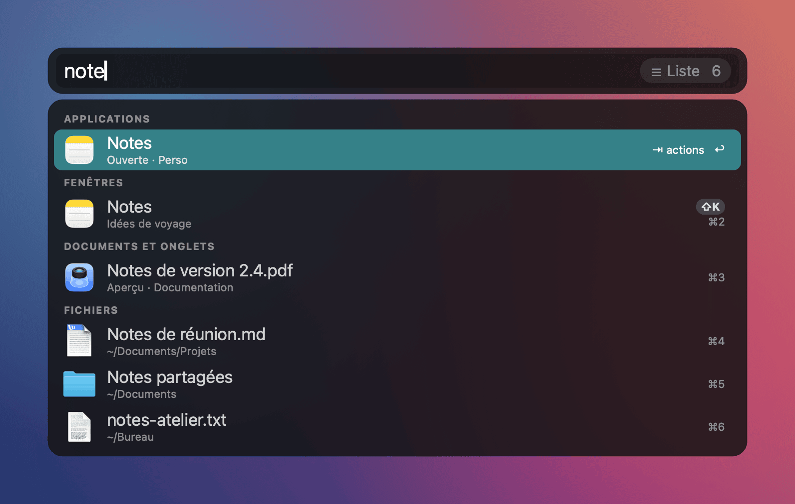
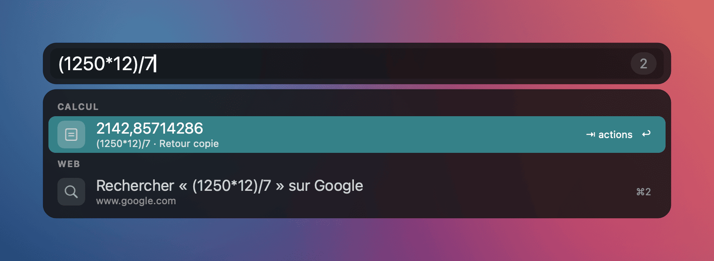
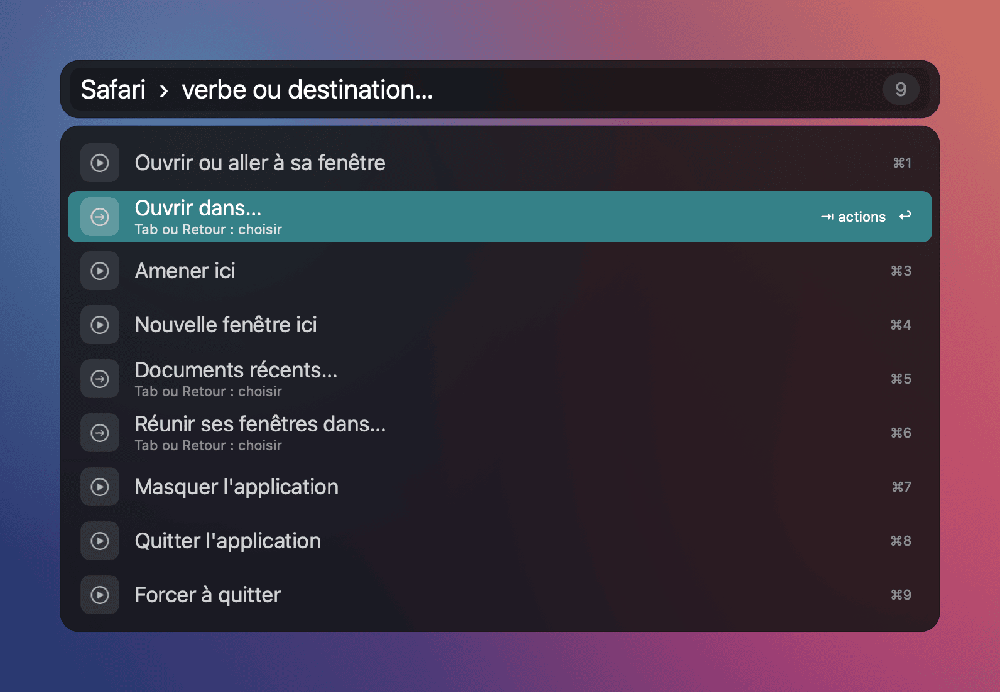
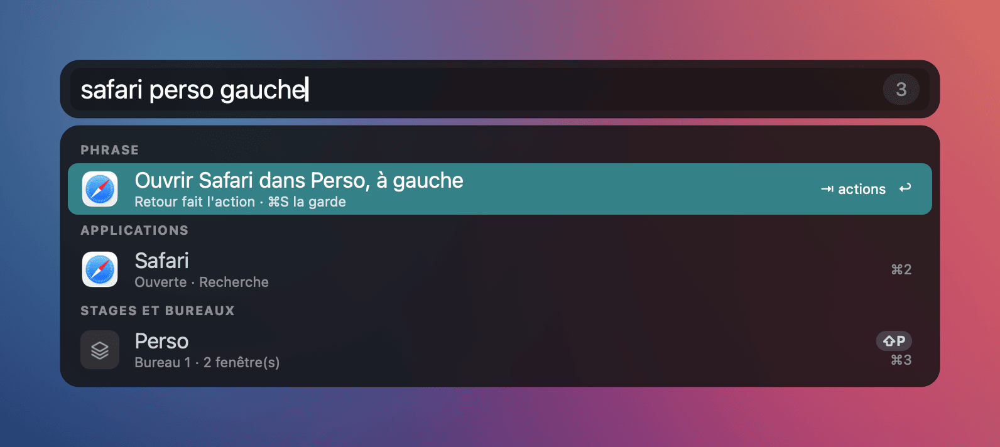
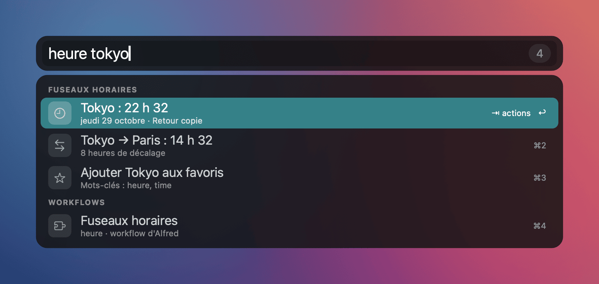
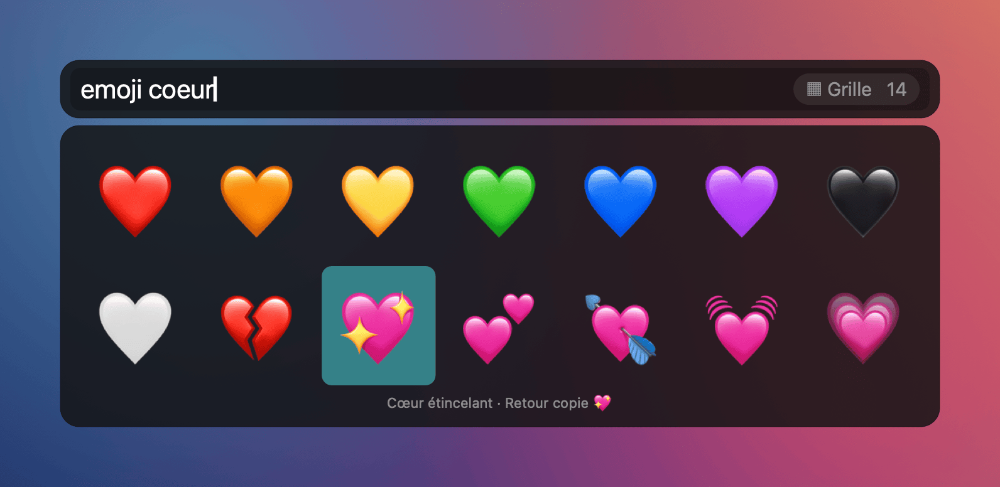
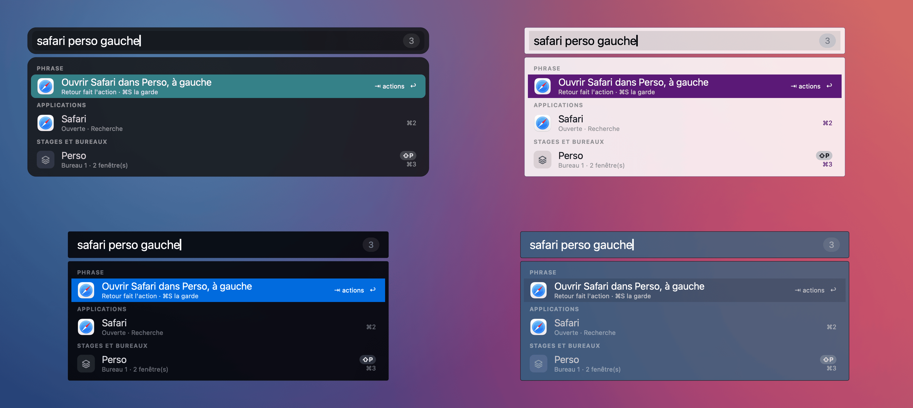
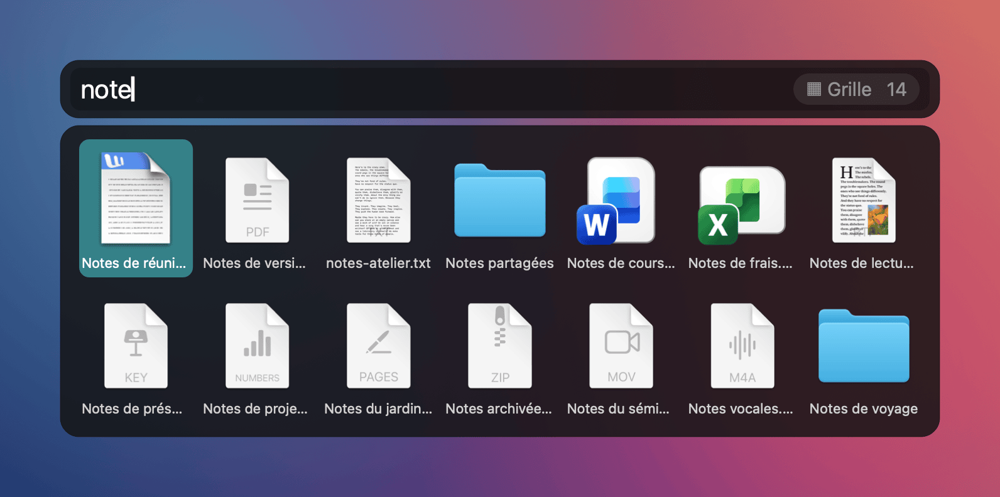

# Lanceur et workflows d'Alfred

[English](../en/launcher.md) · [Documentation](README.md)

La barre de Roadie est un lanceur complet, dans le même processus que le gestionnaire de fenêtres. Elle
trouve et ouvre les applications, les fenêtres, les fichiers et les pages web. Elle sait aussi où placer ce qu'elle
ouvre : dans quelle stage, sur quel bureau, de quel côté de l'écran. Elle fait tourner les workflows
d'Alfred (fichiers `.alfredworkflow`), sans Alfred et sans Powerpack.

> Disponible dans `main` ; la version publiée 0.10.0 ne contient pas encore le lanceur. Il sera dans la prochaine
> version. En attendant, [compilez depuis les sources](../../README.fr.md#build-et-lancement-de-développement).

La barre suit la langue de macOS : en français sur un Mac réglé en français, en anglais sinon. Ce qui se tape
fonctionne dans les deux langues. Les captures de ce guide sont dessinées par le moteur de rendu de Roadie, avec des
fenêtres et des fichiers d'exemple.

## Ouvrir la barre

- Raccourci : ⌘⌃⌥F par défaut (`search_hotkey`, Paramètres > Raccourcis). Il se change par appui sur les touches.
- `roadie targets search` ouvre la même barre (pour BetterTouchTool, Karabiner, un script).
- Échap ferme et rend le clavier à la fenêtre et au champ qui l'avaient.

La barre est vide à l'ouverture ? Elle propose quand même : revenir à la fenêtre précédente, annuler le dernier
déplacement, rouvrir une fenêtre fermée, les applications souvent choisies dans cette stage et les recherches
récentes.

## Chercher

Une seule saisie cherche partout, par sections :

| Section | Ce qui est trouvé |
|---|---|
| Applications | Toutes les applications installées ; une application ouverte indique sa stage |
| Fenêtres | Les fenêtres de tous les bureaux et stages, avec leur vignette réelle |
| Documents et onglets | Le document de chaque fenêtre et les onglets de Chrome, Brave, Edge et Safari |
| Fichiers | Les fichiers déjà ouverts, tout de suite, puis Spotlight dans le dossier personnel |
| Stages et bureaux | Les stages, les bureaux Roadie et les écrans |
| Signets et historique | Firefox (tous les profils, étiquettes, mots-clés), Safari et Chrome |
| Réglages | Les pages et réglages de Roadie, les panneaux des Réglages Système |
| Système | Verrouiller, suspendre les écrans, tout quitter, vider la corbeille, son… |
| Web | Adresse tapée, recherches par mot-clé (`yt chat`, `g`, `wp`), recherche de repli |

La correspondance tolère les initiales (`vsc` trouve Visual Studio Code) et ignore accents et majuscules. Roadie
apprend vos choix : la ligne choisie après une même saisie remonte, en tenant compte de la stage active. Un
fichier déjà ouvert reste devant un fichier jamais ouvert.

Touches utiles :

- ↑ ↓ ou la souris pour choisir, Retour pour ouvrir. ⌘1 à ⌘9 ouvrent directement une ligne.
- Maj + la lettre en pastille (« ⇧K ») ouvre une fenêtre, une stage ou un bureau.
- ⌘ + Retour ouvre dans une nouvelle stage, ⌥ + Retour amène ici, ⌃ + Retour cherche sur le web. La ligne
  annonce l'action tant que la touche est tenue.
- ⌘C copie la ligne (chemin, adresse, résultat), ⌘Y montre l'aperçu Quick Look, ⌘L affiche en grand.
- Une espace en tête ne cherche que des fichiers. `open nom` et `find nom` aussi. `in mots` cherche dans le
  contenu, `tags rouge` par étiquette du Finder.
- `~/Doc` ou `/Applications/` liste le dossier ; Tab complète, ⌫ remonte d'un dossier.
- `> commande` la lance dans Terminal, iTerm, Ghostty, Warp, kitty, WezTerm ou Alacritty.
- Un calcul (`12*4,5`, `=sqrt(2)`) donne son résultat en tête ; Retour le copie.
- Les mots marchent en français et en anglais, quelle que soit la langue de la barre : verbes (`fermer` ou `close`),
  phrases (`gauche` ou `left`, `ici` ou `here`), commandes système (`verrouiller` ou `lock`), bureaux (`bureau 2` ou
  `desktop 2`) et noms d'applications (`Calendrier` ou `Calendar`).

## Agir : verbes, destinations et phrases

Tab (ou →) sur une ligne ouvre ses verbes. Pour une application : ouvrir ou aller à sa fenêtre, ouvrir dans…,
amener ici, nouvelle fenêtre ici, documents récents…, réunir ses fenêtres dans…, masquer, quitter, forcer à
quitter. Pour une fenêtre : aller à, envoyer vers…, amener ici, faire flotter ou tuiler (cette fenêtre ou
toujours l'application), plein écran, réduire, fermer. Un verbe suivi de « … » demande une destination :
stage, bureau, écran ou « Nouvelle stage ».

Pendant le choix d'une stage, les vraies fenêtres prennent leur future place et un fantôme marque la fenêtre à
venir. Échap remet tout en place.

Une phrase complète fait tout d'un coup, en français ou en anglais : `safari perso gauche` ouvre Safari dans la
stage Perso, à gauche. ⌘S garde l'action sous une abréviation et donne la commande `roadie launch … --position …`
à lier dans BetterTouchTool.

Autres actions :

- Sélection multiple : ⌥↑ ⌥↓ réunissent applications, fenêtres et fichiers ; un seul verbe agit sur tous.
- `roadie undo` (ou « Annuler » dans la barre vide) annule le dernier déplacement.
- Projets : une stage nommée se garde (fenêtres, documents, adresses, disposition) et se rouvre telle quelle, même
  après un redémarrage (`roadie project save|open|list|delete`).
- Règles proposées : après trois déplacements semblables, la barre propose d'en faire une règle (💡, ⌘R).

## Workflows d'Alfred, gratuitement

Chez Alfred, les workflows demandent le [Powerpack](https://www.alfredapp.com/powerpack/), payant : 34 £
(licence simple) ou 59 £ (« Mega Supporter », mises à jour à vie). Roadie lit le même format et les fait tourner
gratuitement :

- les workflows déjà installés dans Alfred, lus sans les modifier (dossier synchronisé compris) ;
- ceux de `~/.config/roadies/workflows` : `roadie workflow install X.alfredworkflow`, sans Alfred installé.

Ce qui est repris : mots-clés et Script Filters (avec leur cache), schéma complet (scripts, conditions,
utilitaires, copie et collage, notification, ouverture d'adresse ou de fichier), touches ⌘ ⌥ ⌃ par ligne,
filtres de liste et de fichiers, recherches de repli, actions sur fichier en verbes, déclencheurs externes,
raccourcis (à lier dans BetterTouchTool), grilles, vues Texte, Image et PDF, boutons d'Alfred Remote, tâches
d'automatisation officielles. Quand un script s'adresse à Alfred (`tell application id
"com.runningwithcrayons.Alfred"`), Roadie fait lui-même ce qui est demandé, sans ouvrir Alfred.

Sur un corpus de 102 workflows réels, 92 sont « complets » selon `roadie workflow list`. Cette commande donne
l'état de chaque workflow (complet, partiel, inutilisable) et ce qui manque. Non repris : snippets, historique du
presse-papiers d'Alfred, scripts AppleScript compilés.

Un workflow tourne avec les droits de Roadie, comme dans Alfred : n'installez que ceux que vous connaissez.

Commandes : `roadie workflow list [--hotkeys]`, `check DOSSIER`, `install FICHIER`, `remove ID`,
`run ID OBJET [ARGUMENT]`, `trigger ID DÉCLENCHEUR [ARGUMENT]`, `tasks update`.

## Apparence

Les neuf thèmes d'Alfred sont fournis, avec leurs couleurs, polices, arrondis et flou ; un thème exporté
d'Alfred (`.alfredappearance`) dans `~/.config/roadies/themes` s'ajoute à la liste. Un thème différent peut
servir en mode sombre (`theme_dark`). La barre se place en bas, au centre ou en haut, sur l'écran de la souris
ou de la fenêtre active ; elle se déplace à la souris et retient sa place. Les résultats d'un workflow, d'un
dossier ou d'une recherche de fichiers se montrent en liste, en grille ou en grandes tuiles. La pastille à
droite de la saisie indique la présentation (« ☰ Liste », « ▦ Grille », « ▣ Grandes tuiles ») et le nombre de
résultats ; un clic sur elle, ou ⌘G, passe à la suivante. Roadie retient le choix pour chaque workflow, chaque
dossier et pour les fichiers de la recherche.

## Rapidité

La barre reste réactive quand le Mac est très chargé : les textes de recherche sont préparés une fois, les
icônes réduites en fond, Spotlight interrogé hors du fil principal. Les documents déjà ouverts s'affichent tout de
suite (environ 50 ms) ; Spotlight complète ensuite, sans bousculer ce qui est affiché. Chaque ouverture écrit
ses mesures dans `~/.roadies/events.jsonl` (`launcher.timing`, sans saisie ni titre).

## Réglages et vie privée

Tout se règle dans Paramètres > Recherche et Paramètres > Raccourcis, ou dans `[experimental.target_mode]` de
`~/.config/roadies/roadies.toml`. Le classement appris, l'historique des saisies et les abréviations restent sur
ce Mac, dans `~/.roadies/` ; `roadie launcher reset` et `roadie launcher history --clear` les effacent. Le
journal ne garde ni saisie ni résultat.

Détail de chaque fonction : [guide des fonctionnalités, mode recherche](features.md#mode-recherche).

Alfred est une marque de Running with Crayons Ltd. Roadie n'est ni affilié à Alfred ni approuvé par ses
auteurs ; il lit le format public des workflows.
