# Lanceur et workflows d'Alfred

[English](../en/launcher.md) · [Documentation](README.md)

La barre de Roadie est un lanceur complet, dans le même processus que le gestionnaire de fenêtres. Elle
trouve et ouvre les applications, les fenêtres, les fichiers et les pages web. Elle sait aussi où placer ce qu'elle
ouvre : dans quelle stage, sur quel bureau, de quel côté de l'écran. Elle fait tourner les workflows
d'Alfred (fichiers `.alfredworkflow`), sans Alfred et sans Powerpack.

> Inclus depuis Roadie 0.11.0.

La barre suit la langue de macOS (en français sur un Mac réglé en français, en anglais sinon), ou celle choisie
dans Paramètres > Général > Langue de l'interface. Ce qui se tape fonctionne dans les deux langues. Les captures de ce guide sont dessinées par le moteur de rendu de Roadie, avec des
fenêtres et des fichiers d'exemple.

## Ouvrir la barre

- Raccourci : ⌘⌃⌥F par défaut (`search_hotkey`, Paramètres > Raccourcis). Il se change par appui sur les touches.
- `roadie targets search` ouvre la même barre (pour BetterTouchTool, Karabiner, un script).
- Échap ferme et rend le clavier à la fenêtre et au champ qui l'avaient.

La barre est vide à l'ouverture ? Elle propose quand même : revenir à la fenêtre précédente, annuler le dernier
déplacement, rouvrir une fenêtre fermée, les applications souvent choisies dans cette stage et les recherches
récentes.

## Chercher

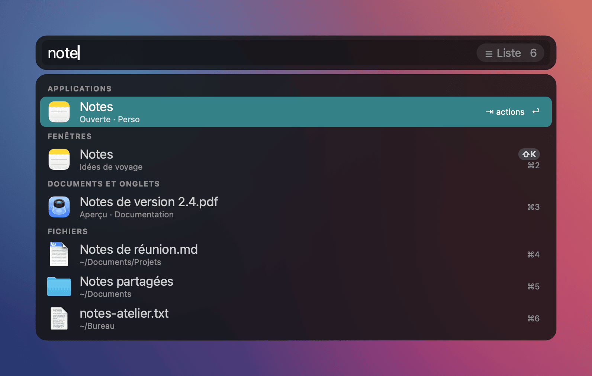

Une seule saisie cherche partout, par sections :

| Section | Ce qui est trouvé |
|---|---|
| Applications | Toutes les applications installées ; une application ouverte indique sa stage |
| Fenêtres | Les fenêtres de tous les bureaux et stages, avec leur vignette réelle |
| Documents et onglets | Le document de chaque fenêtre et les onglets de Chrome, Brave, Edge et Safari |
| Fichiers | Les fichiers déjà ouverts, tout de suite, puis Spotlight dans le dossier personnel |
| Stages et bureaux | Les stages, les bureaux Roadie et les écrans |
| Signets et historique | Firefox (tous les profils, étiquettes, mots-clés), Safari et Chrome |
| Réglages | Les pages et réglages de Roadie, les panneaux des Réglages Système |
| Système | Verrouiller, suspendre les écrans, tout quitter, vider la corbeille, son, mode sombre, captures d'écran, raccourcis de l'app Raccourcis… |
| Web | Adresse tapée, recherches par mot-clé (`yt chat`, `g`, `wp`), recherche de repli |

La correspondance tolère les initiales (`vsc` trouve Visual Studio Code) et ignore accents et majuscules. Roadie
apprend vos choix : la ligne choisie après une même saisie remonte, en tenant compte de la stage active. Un
fichier déjà ouvert reste devant un fichier jamais ouvert.

Touches utiles :

- ↑ ↓ ou la souris pour choisir, Retour pour ouvrir. ⌘1 à ⌘9 ouvrent directement une ligne.
- Maj + la lettre en pastille (« ⇧K ») ouvre une fenêtre, une stage ou un bureau.
- ⌘ + Retour ouvre dans une nouvelle stage, ⌥ + Retour amène ici, ⌃ + Retour cherche sur le web. La ligne
  annonce l'action tant que la touche est tenue. Ces trois effets se règlent dans Paramètres > Recherche, comme
  dans Alfred : nouvelle stage, ici, envoyer sans y aller, web, copier, Finder, aperçu ou verbes.
- ⌘C copie la ligne (chemin, adresse, résultat), ⌘Y montre l'aperçu Quick Look, ⌘L affiche en grand.
- Une espace en tête ne cherche que des fichiers. `open nom` et `find nom` aussi. `in mots` cherche dans le
  contenu, `tags rouge` par étiquette du Finder.
- `~/Doc` ou `/Applications/` liste le dossier ; Tab complète, ⌫ remonte d'un dossier.
- `> commande` la lance dans Terminal, iTerm, Ghostty, Warp, kitty, WezTerm ou Alacritty.
- `menu exporter` cherche dans les menus de l'application qui était au premier plan ; Retour choisit l'élément.
- `apps` montre toutes les applications en grille, par catégorie, celles épinglées en tête (comme le Launchpad
  d'Alfred 6) ; `apps mus` filtre. `symbols heart` ouvre le navigateur SF Symbols : grille, nom, catégories,
  aperçu en quatre tailles et version minimale de chaque système ; Retour copie le nom.
- Un calcul (`12*4,5`, `=sqrt(2)`) donne son résultat en tête ; Retour le copie.
- **Convertisseur intégré** (`calc_conversions`, activé par défaut) : longueurs, masses, températures, données, temps, vitesses (`100 km in mi`, `25 c in f`, `512 MB in GB`), bases (`0xff in dec`, `255 in bin`) et fuseaux horaires (`14:00 NYC in Paris`), 100 % hors ligne.
- **Minuteur & Pomodoro** (`timer_enabled`) : `timer 15m pause`, `pomodoro`, `timer status`, `timer stop` (aussi via `roadie timer`), avec notification macOS locale.
- **Pipette de couleur** : tape `pipette` ou `color picker` pour prélever une couleur à l'écran via `NSColorSampler` ; Roadie copie `#RRGGBB` et notifie HEX, RGB et HSL.
- **Émojis & symboles intégrés** (`emoji_picker`) : `:fusée` ou `emoji cœur` ouvre le catalogue bilingue FR/EN en grille sans installer de workflow.
- **Presse-papiers sécurisé & snippets locaux** : `cb` / `clipboard` parcourt l'historique local (`~/.roadies/clipboard.json`, `0o600`, mots de passe exclus) ; `snip` / `snippet` recherche et copie l'expansion des snippets (`{date}`, `{time}`, `{datetime}`, `{clipboard}`, `{cursor}`).
- Les mots marchent en français et en anglais, quelle que soit la langue de la barre : verbes (`fermer` ou `close`),
  phrases (`gauche` ou `left`, `ici` ou `here`), commandes système (`verrouiller` ou `lock`), bureaux (`bureau 2` ou
  `desktop 2`) et noms d'applications (`Calendrier` ou `Calendar`).

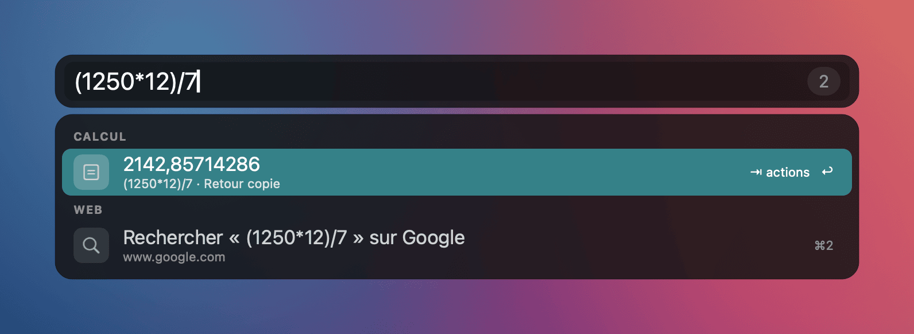

## Outils intégrés, presse-papiers sécurisé et snippets

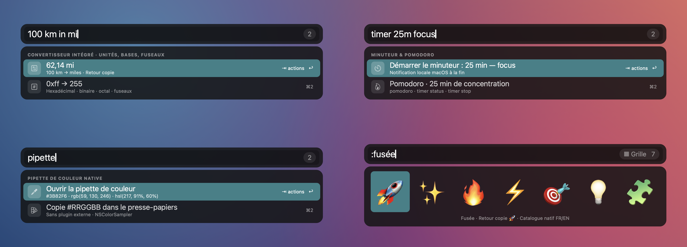

Quatre utilitaires du quotidien fonctionnent directement dans le cœur du lanceur, sans workflow externe ni accès réseau : convertisseur d'unités/bases/fuseaux, minuteur/Pomodoro local, pipette native `NSColorSampler` et catalogue d'émojis/symboles FR/EN.

<table>
  <tr>
    <td>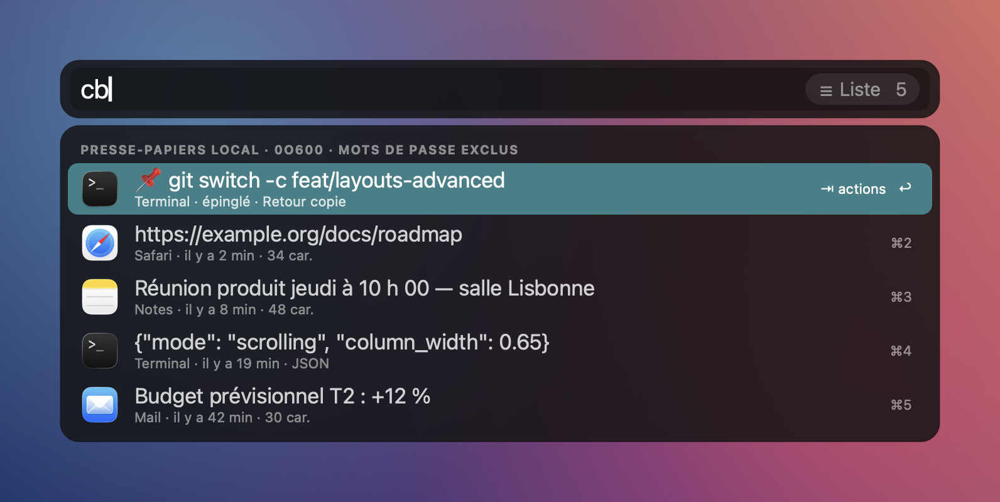</td>
    <td>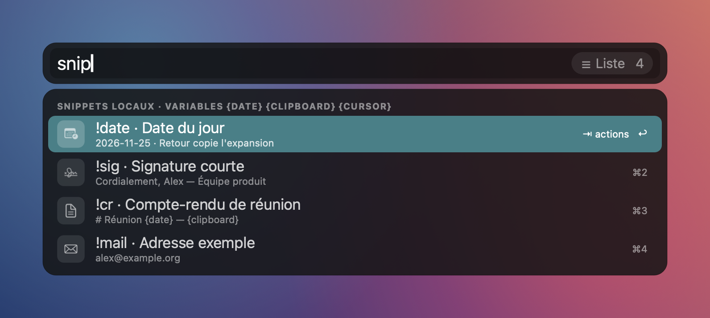</td>
  </tr>
</table>

- **Presse-papiers local (`[clipboard]`, activé par défaut)** : conserve jusqu'à `max_items = 200` entrées pendant `retention_days = 7` jours dans `~/.roadies/clipboard.json` (écriture atomique `0o600`, jamais journalisé dans `events.jsonl`). Les types sensibles (`ConcealedType`, `TransientType`, `AutoGeneratedType`) et les gestionnaires de mots de passe (1Password, Bitwarden, KeePassXC, Trousseau d'accès, LastPass, Dashlane) sont systématiquement ignorés. Aussi pilotable en CLI : `roadie clipboard list|search|copy|pin|delete|clear [--all]`.
- **Snippets locaux (`[snippets]`)** : définis dans `[[snippets.items]]` ou dans **Paramètres > Recherche > Snippets**. Expansion mono-passe de `{date}`, `{time}`, `{datetime}`, `{clipboard}` et `{cursor}` (sans ré-expansion du contenu collé). Auto-expansion clavier globale optionnelle (`snippets.auto_expand = false` par défaut, toujours suspendue lors de la saisie sécurisée macOS). Aussi en CLI : `roadie snippet list|expand MOT_CLE [--copy]`.

## Agir : verbes, destinations et phrases

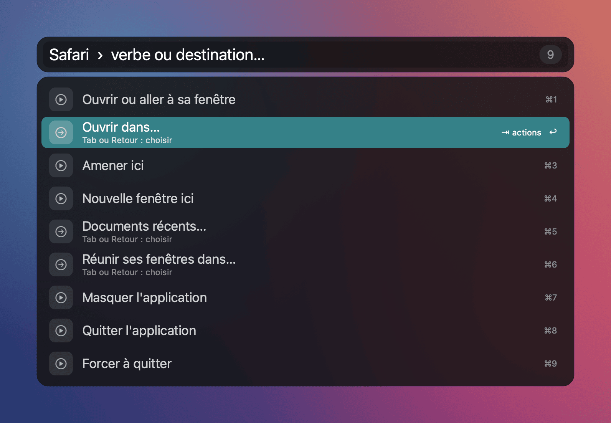

Tab (ou →) sur une ligne ouvre ses verbes. Pour une application : ouvrir ou aller à sa fenêtre, ouvrir dans…,
amener ici, nouvelle fenêtre ici, documents récents…, réunir ses fenêtres dans…, masquer, quitter, forcer à
quitter. Pour une fenêtre : aller à, envoyer vers…, amener ici, faire flotter ou tuiler (cette fenêtre ou
toujours l'application), plein écran, réduire, fermer. Un verbe suivi de « … » demande une destination :
stage, bureau, écran ou « Nouvelle stage ».

Les actions d'Alfred sont aussi là. Une application se relance, quitte toutes les autres ou s'épingle dans Apps.
Un fichier (ou plusieurs, en sélection multiple) se copie dans le presse-papiers, se copie ou se déplace vers un
dossier (tapez un chemin, ou choisissez un dossier habituel ou récent ; « en remplaçant » met d'abord l'ancien à
la corbeille), s'ouvre avec une autre application, part par e-mail, va à la corbeille, reçoit un alias, une
étiquette du Finder, ou ouvre sa fenêtre d'informations du Finder (⌘I). Un dossier se parcourt dans la
barre ou ouvre un terminal ; un paquet montre son contenu. Un texte (Tab sur la recherche web, ou Capslock + Maj
+ F avec un texte sélectionné) se copie, se cherche sur le web, part par e-mail, s'affiche en grand ou donne ses
adresses web et e-mail, chacune avec ses verbes. Un onglet ouvert se ferme, donne son adresse ou s'ouvre dans une
nouvelle fenêtre. Les actions universelles des workflows s'ajoutent aux verbes des textes, adresses et fichiers.

Pendant le choix d'une stage, les vraies fenêtres prennent leur future place et un fantôme marque la fenêtre à
venir. Échap remet tout en place.

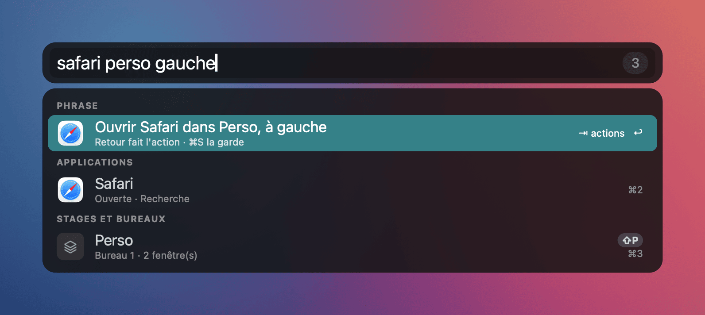

Une phrase complète fait tout d'un coup, en français ou en anglais : `safari perso gauche` ouvre Safari dans la
stage Perso, à gauche. ⌘S garde l'action sous une abréviation et donne la commande `roadie launch … --position …`
à lier dans BetterTouchTool.

Autres actions :

- Sélection multiple : ⌥↑ ⌥↓ réunissent applications, fenêtres et fichiers ; un seul verbe agit sur tous.
- `roadie undo` (ou « Annuler » dans la barre vide) annule le dernier déplacement.
- Projets (scènes de travail) : une stage nommée se garde (fenêtres, documents, adresses, applications à relancer, notes et disposition) et se rouvre telle quelle, même après un redémarrage (`roadie project save [NOM] --url ... --app ... --note ...`, `open`, `info`, `list`, `delete`).
- Actions Roadie depuis la barre : `Scratchpad (afficher/masquer)`, `Mode Onglets (tabbed)`, `Mode Ruban défilant (scrolling)`, `Pivoter le layout`, `Miroir du layout`, `Rassembler l'application`.
- Règles proposées : après trois déplacements semblables, la barre propose d'en faire une règle (💡, ⌘R).

## Workflows d'Alfred, gratuitement

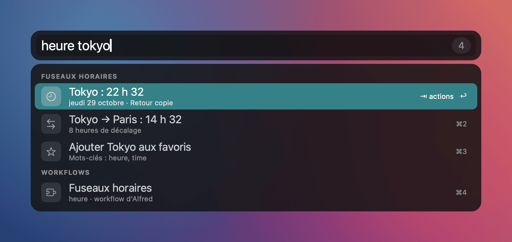

Chez Alfred, les workflows demandent le [Powerpack](https://www.alfredapp.com/powerpack/), payant : 34 £
(licence simple) ou 59 £ (« Mega Supporter », mises à jour à vie). Roadie lit le même format et les fait tourner
gratuitement :

- les workflows déjà installés dans Alfred, lus sans les modifier (dossier synchronisé compris) ;
- ceux de `~/.config/roadies/workflows` : `roadie workflow install X.alfredworkflow`, sans Alfred installé.

Ce qui est repris : mots-clés et Script Filters (avec leur cache), schéma complet (scripts, conditions,
utilitaires, copie et collage, notification, ouverture d'adresse ou de fichier), touches ⌘ ⌥ ⌃ par ligne,
filtres de liste et de fichiers, recherche dans le dictionnaire, applications ouvertes, commandes système et de
Musique, recherches de repli, actions sur fichier, texte et adresse en verbes, déclencheurs externes, raccourcis
(à lier dans BetterTouchTool), grilles, vues Texte (tableaux Markdown compris), Image et PDF, boutons d'Alfred
Remote, tâches d'automatisation officielles (téléchargées à leur première utilisation). Quand un script s'adresse à Alfred (`tell application id
"com.runningwithcrayons.Alfred"`), Roadie fait lui-même ce qui est demandé, sans ouvrir Alfred.

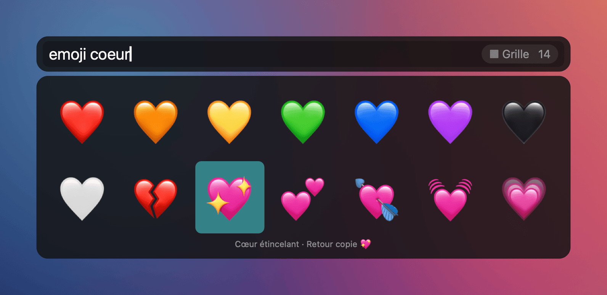

Sur un corpus de 102 workflows réels, 92 sont « complets » selon `roadie workflow list`. Cette commande donne
l'état de chaque workflow (complet, partiel, inutilisable) et ce qui manque. Non repris d'Alfred : Contacts,
format propriétaire des snippets/presse-papiers d'Alfred (Roadie propose son propre presse-papiers sécurisé `cb` et
ses propres snippets locaux `snip`), scripts AppleScript compilés, IA et transformation de texte d'Alfred 6.

Un workflow tourne avec les droits de Roadie, comme dans Alfred : n'installez que ceux que vous connaissez.

Commandes : `roadie workflow list [--hotkeys]`, `check DOSSIER`, `install FICHIER`, `remove ID`,
`run ID OBJET [ARGUMENT]`, `trigger ID DÉCLENCHEUR [ARGUMENT]`, `tasks update`.

## Apparence

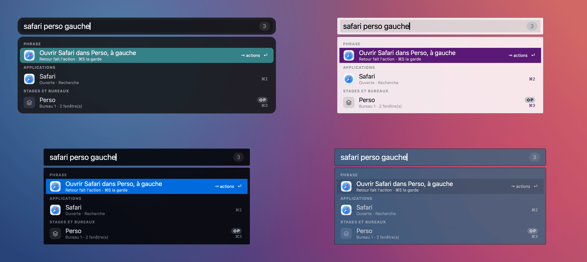

Les neuf thèmes d'Alfred 5 et les deux thèmes en verre d'Alfred 6 (Glassy Dark, Glassy Light) sont fournis, avec
leurs couleurs, polices, arrondis et flou ; un thème exporté
d'Alfred (`.alfredappearance`) dans `~/.config/roadies/themes` s'ajoute à la liste. Un thème différent peut
servir en mode sombre (`theme_dark`). La barre se place en bas, au centre ou en haut, sur l'écran de la souris
ou de la fenêtre active ; elle se déplace à la souris et retient sa place. Les résultats d'un workflow, d'un
dossier ou d'une recherche de fichiers se montrent en liste, en grille ou en grandes tuiles. La pastille à
droite de la saisie indique la présentation (« ☰ Liste », « ▦ Grille », « ▣ Grandes tuiles ») et le nombre de
résultats ; un clic sur elle, ou ⌘G, passe à la suivante. Roadie retient le choix pour chaque workflow, chaque
dossier et pour les fichiers de la recherche. Les fenêtres des workflows (Texte, Image, PDF) et le navigateur SF
Symbols prennent le style choisi (`workflow_view_style`) : comme macOS, couleurs du thème, ou les styles d'Alfred 6
Glassy Dark, Flat Dark et Glassy Light.

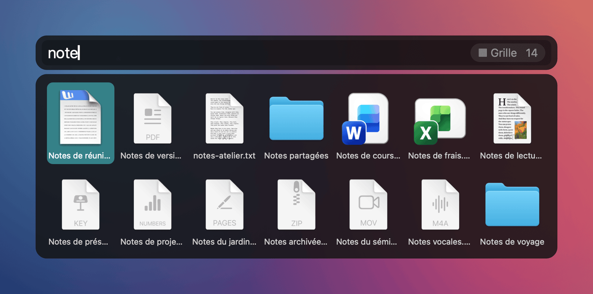

<a id="file-dialog-jump"></a>
## Saut direct dans les dialogues « Ouvrir / Enregistrer sous »

Quand un panneau macOS `NSOpenPanel` / `NSSavePanel` est ouvert (y compris les feuilles XPC sandboxées comme TextEdit ou Aperçu), ouvrir la barre Roadie place immédiatement en tête vos dossiers favoris (**Desktop / Bureau**, **Downloads / Téléchargements**, **Documents**, **Nextcloud**, dossier personnel), vos dossiers de projets et vos dossiers récents. Dès que tu tapes un nom (`desktop`, `bureau`, `39.roadie`…), les dossiers correspondants remontent en #1 et `Entrée` téléporte directement la boîte de dialogue via *Aller au dossier* (`⌘⇧G` + écriture Accessibilité directe dans le nouveau champ) — **sans perdre le nom du fichier en cours d’enregistrement ni toucher au presse-papiers**. Interrupteur : `launcher.file_dialog_jump` (activé par défaut, zéro polling).

## Historique clavier (`↑` / `↓`)

Quand la sélection est tout en haut de la liste (ou barre vide), la flèche Haut **`↑`** remonte dans les **20 dernières saisies** du lanceur et **`↓`** redescend jusqu’au brouillon en cours. Interrupteur : `launcher.history_arrow_navigation` (activé par défaut).

<a id="vision-ocr"></a>
## Recherche à l’écran & OCR local Apple Vision au mot exact

La recherche à l’écran (`⌘⌃⌥F` par défaut, `roadie targets screen`) scanne les éléments visibles de toutes les fenêtres et les encadre à mesure que tu tapes. En activant **OCR local sur l’écran (Apple Vision)** dans **Paramètres > Général → Modules activables** (`experimental.app_targets.ocr_fallback = true`, **désactivé par défaut : `0 Mo` et `0` capture tant qu’éteint**), Roadie lit aussi le texte affiché à l’écran en 100 % local et encadre **le mot exact** recherché (avec `ocr_fallback_threshold = 0` par défaut, réglable `1–30` pour le limiter aux apps pauvres en Accessibilité) :

- **`⇧ + lettre`** (`⇧A`, `⇧S`…) : clique directement sur l’étiquette correspondante.
- **`↓` / `↑`** : déplace le surlignage entre les résultats.
- **`Entrée`** (clic simple), **`Entrée` × 2** (double-clic), **`⇧ + Entrée`** (clic droit), **`⌘ + Entrée`** (⌘-clic).

## Rapidité

La barre reste réactive quand le Mac est très chargé : les textes de recherche sont préparés une fois, les
icônes réduites en fond, Spotlight interrogé hors du fil principal. Les documents déjà ouverts s'affichent tout de
suite (environ 50 ms) ; Spotlight complète ensuite, sans bousculer ce qui est affiché. Chaque ouverture écrit
ses mesures dans `~/.roadies/events.jsonl` (`launcher.timing`, sans saisie ni titre).

## Réglages et vie privée

Tout se règle dans Paramètres > Recherche et Paramètres > Raccourcis, ou dans `[experimental.target_mode]` de
`~/.config/roadies/roadies.toml`. Le classement appris, l'historique des saisies et les abréviations restent sur
ce Mac, dans `~/.roadies/` ; `roadie launcher reset` et `roadie launcher history --clear` les effacent. Le
journal ne garde ni saisie ni résultat.

Détail de chaque fonction : [guide des fonctionnalités, mode recherche](features.md#mode-recherche).

Alfred est une marque de Running with Crayons Ltd. Roadie n'est ni affilié à Alfred ni approuvé par ses
auteurs ; il lit le format public des workflows.

## Section Launcher

Les réglages du lanceur se placent dans `[launcher]`. Cette section accepte les mêmes
clés que l'ancienne `[experimental.target_mode]`, y compris les touches et la recherche
à l'écran. Les anciens fichiers restent valides. Si une clé figure aux deux endroits,
`launcher` gagne ; les autres valeurs anciennes restent en vigueur. Un tableau nouveau
remplace tout le tableau ancien. Les Paramètres déplacent seulement la clé éditée vers
`launcher`. Une remise à zéro retire ses deux formes. Les commentaires restent.

```toml
[launcher]
theme = "alfred"
visible_results = 7
bookmarks_enabled = true
```

Les identifiants des commandes de réglage (`target_mode.…`) restent stables. Pour revenir
à une ancienne version de Roadie, remettre les clés sous `experimental.target_mode` ou
reprendre la sauvegarde de configuration. Aucune migration automatique au démarrage.
